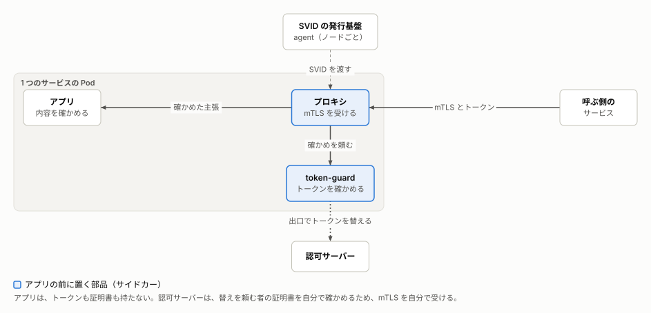
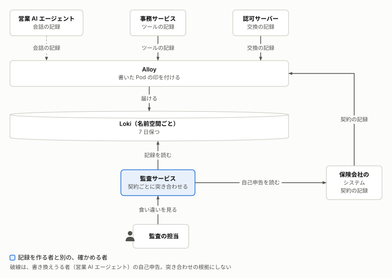

# アーキテクチャ

営業 AI エージェントが顧客と保険会社の間に入る保険の申込みを、どのような構成で動かし、要件をどの仕組みで満たすかを示す。

**この文書の読み手:** 実装や設計をする人。OAuth と JWT、Kubernetes（Pod、名前空間）の基本を知っている。読んだ後に、システムの構成と処理の流れ、認証・認可と署名の方式と選んだ標準、誰が何を確かめるか、制約と限界を説明できる。アクセストークン（権限を渡した証拠となる、署名つきのデータ）を、以下トークンと呼ぶ。**（仮称）** は、この設計での呼び名で、標準の用語ではない。登場するものの呼び名は、[AI に取引を任せるときに、確かめるべきこと](purpose.md)の 5 章に合わせる。窓口の確認の考え方は同じ文書に、用語（SPIFFE、SVID、DPoP など）は[用語集](glossary.md)、根拠の事実と判断は[ナレッジの索引](knowledge/README.md)の ID（F-G1、D-1 など）にある。

## 要旨
- **構成:** 顧客のアプリ、営業 AI エージェント、事務サービス、認可サーバー、保険会社のシステム、監査サービスの 6 つのサービスで動く。顧客のアプリを除くサービスは、1 つのクラスタの中で動き、SPIFFE の mTLS でつながる。トークンは、各サービスの前のプロキシと token-guard が確かめ、アプリは内容だけを確かめる。営業 AI エージェントは、顧客と保険会社の間で案と申込みを運ぶ中継者で、鍵も記録も持たない。
- **方式:** 各段の呼び出しは、認可サーバーが出すトークン A・B・C で、顧客の依頼だと示す。トークンは、全段で送信者の鍵に結ぶ。申込みの内容は、利用者の鍵で端末が署名する。事後の確認は、AI を通らない直送と照合と、第三者の記録との突き合わせで行う。
- **要件:** 12 件の要件を、AI と独立した証明と署名、AI を通らない経路と記録で満たす。満たすかは、要件ごとのシナリオの自動テストで確かめる。人が状況を読んで止める統制は、要件の外にある（6 章）。
- **限界:** 署名前の画面の信頼、署名を押す前の判断、第三者の情報の強さは、この方式では確かめきれない。サービスの身元を配る基盤と、プロキシを信頼することが前提である。

## 1. システム概要: AI が顧客の代理で保険会社に申し込む
### 1-1. 目的と利用者: AI の言い分を、AI と独立した情報で確かめる
このシステムでは、営業 AI エージェントが、顧客の代理で保険会社に保険を申し込む。[AI に取引を任せるときに、確かめるべきこと](purpose.md)が示す課題、つまり AI の言い分を AI と独立した情報で確かめることを、構成と方式で解く。

営業 AI エージェントは、顧客の意向を聞いて、案を顧客に示す。顧客は、顧客のアプリで案を選び、利用者の鍵（passkey）で署名する。営業 AI エージェントは、署名済みの申込みを、顧客の代理として事務サービスへ運ぶ。事務サービスは、申込みを保険会社のシステムへ回す。

- **題材:** 無選択型の個人年金保険で、契約者が被保険者と年金の受取人を兼ねる契約とする。年金の定めがあるので、締結のときに取引時確認が要る（I-B10）。告知と医師の診査は要らない（I-B11）。
- **利用者:** 顧客（申し込む本人）。自分の端末の顧客のアプリで署名する。
- **外部への依存:** 営業 AI エージェントの推論を担うモデルの提供元と、利用者の端末の認証器（passkey）。
- **システムの境界:** 2 章の 6 つのサービスと、それを動かす基盤（クラスタ、SVID の発行基盤、プロキシ）。保険会社の側は、事務サービス、認可サーバー、保険会社のシステム、監査サービスの 4 つである。営業 AI エージェントも保険会社のクラスタの中で動くが、書き換えうる中継者として扱い、ほかのサービスはその言い分を信頼しない。

### 1-2. 要件: 守ることと避けることを、方式に依らない形で 12 件定める
要件は、システムが最低限守ることと、絶対に避けることを書く。実現の方式は書かない。方式を書くと、検討の幅を狭めるからである（C-8、C-9）。方式は 4 章に、確かめる項目は[シナリオ](scenarios.md)の防御の表（2-3）にある。

要件は、purpose が扱う場面（顧客が営業 AI エージェントに申込みを任せる）の中に限る。purpose の 3 つの確認と時点に、窓口の統制が実現したかったことを当てはめたものである。主の流れに加えて、例外の流れの要件も含める。例外の流れは、purpose が主題をぼやけさせないために描いていないが、同じユースケースの一部である。書き方は、次のとおりである。
- **型:** 守ることは「常に」の型、避けることは「望まない事態」の型（〜場合、システムは〜しない）で書く（C-7）。
- **合格の基準:** 満たしたかを判定する条件を書き、確かめるシナリオの番号を括弧で添える（C-8）。シナリオは、[シナリオ](scenarios.md)の番号で、自動テストで確かめる。要件を足すときに、確かめるシナリオがなければ、シナリオを足す。
- **由来:** 窓口の統制が実現したかったこと（[窓口のたとえ話の中身と根拠](knowledge/notes/window-story.md)の統制の表の「実現したいこと」）を書く。統制の元になった規則の事実の ID は、その表にある。窓口に対応する統制がない要件は、purpose のどの確認の、どの流れから導いたかを書く。
- **並び:** 時点、確認の順に並べる。同じ時点と確認の中は、要件が対象とする出来事が、3 章の処理の段で起きる順にする。

| 要件 | 時点・確認 | 型 | 由来 | 合格の基準 |
|---|---|---|---|---|
| 1. 本人確認が済んだと確かめられない申込みが届いた場合、システムは受け付けない。営業 AI エージェントの申告は、確かめた根拠にならない | 取引のとき・誰の依頼か | 望まない事態 | なりすましを防ぐ | 本人確認の済んでいない人の申込みが、契約にならない（シナリオ 6） |
| 2. 本人が依頼していない申込みが、本人の名義で届いた場合、システムは受け付けない。営業 AI エージェントの申告は、誰の申込みかの根拠にならない | 取引のとき・誰の依頼か | 望まない事態 | 誰の依頼か。AI の言い分のまま本人を決めると、他人名義の申込みが通る（purpose の 3 章、5-1） | 本人が依頼していない申込みが、本人名義の契約にならない（シナリオ 1〜5） |
| 3. 本人でも、本人が代理を許した者でもない者が、契約の情報を求めた場合、システムは示さない。盗んだ証明を示しても、示さない | 取引のとき・誰の依頼か | 望まない事態 | 誰の依頼か、の例外の流れ。確かめを省くと、情報が漏れる（purpose の 5-4） | 盗んだ証明で、本人の契約の情報を得られない（シナリオ 22、23） |
| 4. 顧客に示されていない案や、示した案と違う案での申込みが届いた場合、システムは受け付けない | 取引のとき・内容は依頼どおりか | 望まない事態 | 恣意的な誘導を防ぐ | 示されていない案や、示した案と違う案での申込みが、契約にならない（シナリオ 8） |
| 5. 顧客が確認して承認した内容と違う申込みが届いた場合、システムは受け付けない | 取引のとき・内容は依頼どおりか | 望まない事態 | 提案と意向のずれを防ぐ。申込内容の後出し変更と、署名のあとの書き換えを防ぐ | 顧客が承認した内容と違う申込みが、契約にならない（シナリオ 7、9） |
| 6. 同じ申込みが二度届いた場合、システムは、二つめを契約にしない | 取引のとき・内容は依頼どおりか | 望まない事態 | 内容は依頼どおりか、の例外の流れ。一度頼んだ申込みが、二度出される | 同じ申込みを二度出しても、契約は一つだけになる（シナリオ 11） |
| 7. システムは、契約を、顧客が承認した申込みの内容のとおりに記録する | 取引のとき・内容は依頼どおりか | 常に | 選んだ案と違う内容の契約を防ぐ | 記録された契約の内容が、承認された申込みの内容と一致する（シナリオ 10） |
| 8. 保険会社に登録されていない、または登録が外れた営業 AI エージェントが取り次いだ申込みが届いた場合、システムは受け付けない | 取引のとき・権限の範囲内か | 望まない事態 | 資格のない者の募集と、立場の誤認を防ぐ | 登録が外れた営業 AI エージェントが取り次いだ申込みが、契約にならない（シナリオ 18） |
| 9. 営業 AI エージェントに許された範囲（契約の種類、上限）を超える申込みが届いた場合、システムは受け付けない | 取引のとき・権限の範囲内か | 望まない事態 | 資格のない者の募集と、立場の誤認を防ぐ | 範囲を超える申込みが、契約にならない（シナリオ 12、13） |
| 10. 取り次ぐことを許されていない者や経路から申込みが届いた場合、システムは受け付けない | 取引のとき・権限の範囲内か | 望まない事態 | 権限の範囲内か、の例外の流れ。取り次ぐことを許されていない者や経路から、申込みが届く（purpose の 5-2） | 許されていない者や経路から届いた申込みが、契約にならない（シナリオ 14〜17、21） |
| 11. システムは、契約内容を、営業 AI エージェントを経ずに、本人が登録した連絡先へ届け、顧客が承認した内容と照らせるようにする | 事後・誰の依頼か、内容は依頼どおりか | 常に | 運ぶ途中の書き換えと、無断の契約を見つける。架空の申込みと、送り先のすり替えを見つける | 契約内容が、営業 AI エージェントを経ずに本人の連絡先へ届き、食い違いが照合で見つかる（シナリオ 10、19） |
| 12. システムは、誰が何を承認し、誰が取り次いだかを、後から示せるように残す | 事後・権限の範囲内か | 常に | 後日、何を説明し、何を確かめたかを追う。内部の不正を防ぎ、見つける | 契約の記録から、承認された内容と、取り次いだ者の経由を示せる（シナリオ 20） |

### 1-3. 対象外: 要件にしないもの
次のものは、このシステムの対象外で、要件にしない（[設計の目標と非目標](knowledge/notes/design-scope.md)）。
- 自分でアプリを操作できない顧客の募集。高齢者の募集の措置（I-B9）を含め、対面の窓口で扱う（P-15）。
- 保険の引受の判断（加入の査定の中身。I-D1）。
- 保険の対象物の所有などの適格の確認（I-X1）。
- 所属する保険会社の賠償責任。技術では決まらない（I-H1）。
- purpose が扱う場面の外のこと。推奨の示し方と誘導の防止（P-3）、保険料の払込、取消（P-5）、不審な取引の検知（D-8）は、要件にしない。
- 法令や監督指針への適合の判断。
- 特定の製品や実装の提供。

## 2. システム構成: 6 つのサービスで、AI は鍵も記録も持たない
### 2-1. サービス: 窓口の登場人物に対応し、AI を通らない者が記録を確かめる
6 つのサービスは、purpose の窓口の登場人物と、会社による監査に対応する（purpose の 5 章の置き換えと同じ）。認可サーバーは、窓口の 4 者にはなく、purpose の 5 章で「保険会社が発行した証明」を出す者に当たる。

| サービス | 窓口の登場人物 | 担うこと | 持つもの |
|---|---|---|---|
| 顧客のアプリ（customer-app） | 顧客 | 顧客が使う。案の署名を確かめてから示し、署名する内容そのものから確認画面を描き、利用者の鍵で署名する。直送された契約内容を、手元の写しと照合する | DPoP の鍵、署名済み申込の写し、受信箱の番号、届いた契約内容 |
| 営業 AI エージェント（sales-agent） | 営業員 | 顧客の意向を聞いて案を示す。顧客が選んだ案から、意向確認と申込みの案を作る（D-27）。顧客から受け取ったトークン A を B に替え、顧客が署名した申込みを、顧客の代理として事務サービスへ運ぶ。AI（Claude）が担い、推論は外部のモデルの提供元に頼む | なし（鍵も記録も持たない） |
| 事務サービス（insurer-mcp） | 事務担当 | 営業 AI エージェントが呼ぶ窓口。自分宛てのトークン B だけを受け付け、保険会社のシステム宛てのトークン C に替えて、保険会社のシステムを呼ぶ | ツールの呼び出しの記録 |
| 認可サーバー（insurer-auth） | なし（証明を出す保険会社） | 本人確認の記録と利用者の公開鍵を持ち、ログインでトークン A を発行し、A を B に、B を C に替える。サービスを SPIFFE ID で登録し、有効性の問い合わせに答える | 本人確認の記録、利用者の公開鍵、顧客が登録した連絡先（受信箱の番号）、トークンの発行の鍵、サービスの登録と失効、交換の記録 |
| 保険会社のシステム（insurer-backend） | 保険会社のシステム | 案に署名して示す。申込みの内容と署名の連鎖を検証し、契約の記録を作り、契約内容を顧客のアプリへ直接送る | 提示の署名の鍵、商品、`nonce`、契約の記録、直送の記録 |
| 監査サービス（insurer-audit） | 会社による監査 | 保険会社のシステムの契約の記録を、認可サーバーの交換の記録と、事務サービスのツールの記録と、契約ごとに突き合わせる。監査の担当に、食い違いを示す（D-17） | 突き合わせの結果 |

営業 AI エージェントは鍵も記録も持たないので、案の中身も顧客の署名も作れない。営業 AI エージェントは、証明と署名を出す者にはならない（4 章）。案を選ぶのは、顧客である。

経路は 3 種類ある。
- **AI が運ぶ申込みと証明の経路（実線）:** 顧客のアプリから営業 AI エージェント（署名済みの申込みと A）、事務サービス（B）、保険会社のシステム（C）へ流れる。
- **AI が触れない、顧客との直接の経路（破線）:** 顧客のアプリが、認可サーバーにログインして A を受け取り、passkey と受信箱を登録する。保険会社のシステムが、契約内容を顧客のアプリの受信箱へ直接送る。顧客のアプリは、提示の公開鍵を、配信元を通して保険会社のシステムから受け取る。
- **証明を替える経路（点線）:** 営業 AI エージェントが A を B に、事務サービスが B を C に、認可サーバーで替える。顧客は関わらない。

サービスどうしの経路は、全て SPIFFE の mTLS で、許した相手の間だけに限る（2-3、D-16）。

### 2-2. サービスの組み立て: プロキシと token-guard がトークンを確かめ、アプリはトークンも証明書も持たない
クラスタの中の各サービスは、アプリの前に、プロキシと token-guard を置く（D-16）。採る製品は、2-3 にある。

| 部品 | 担うこと | 持つもの |
|---|---|---|
| プロキシ | SVID の発行基盤の agent から受け取った SVID で、mTLS を受け、また相手につなぐ。受け口では token-guard に確かめを頼み、確かめた主張だけをアプリに渡す | SVID（SVID の発行基盤が配り、入れ替える） |
| token-guard | 受け口では、相手の SPIFFE ID、トークンの署名・`iss`・`aud`・`exp`・`typ`、DPoP、送信者の鍵への結び付けを確かめる。出口では、`actor_token` を付けて、認可サーバーでトークンを替える | なし（鍵はプロキシの SVID を使う） |
| アプリ | 内容を確かめる。署名の連鎖、内容の一致、案の署名、`nonce`、取決めの範囲、`sub` から顧客を決めること、記録 | 2-1 の表の「持つもの」 |

認可サーバーは、例外として、mTLS を自分で受ける。替えを頼む者の証明書を、クライアント認証と、出すトークンの結び付けに、そのまま使うためである（D-7、D-19）。プロキシが持つ JWT の検証の機能は、DPoP、`cnf`、`typ` を確かめられないので、トークンの確かめは token-guard に置く（F-G46、F-G47）。

### 2-3. 基盤: SPIRE が身元を配り、NetworkPolicy が経路を限る
顧客のアプリは、利用者の端末のブラウザで動く。それ以外のサービスは、保険会社の 1 つの Kubernetes のクラスタの中で、Pod として動く（D-20）。認可サーバーは Spring Authorization Server で作り（D-19）、ほかのサービスはこのシステムのアプリである。各 Pod の組み立て（2-2）は、次の部品が支える。

| 部品 | 担うこと | 採るもの |
|---|---|---|
| プロキシと token-guard | 各 Pod で、アプリの前に置く（2-2） | プロキシは Envoy（D-16）、token-guard はこのシステムの部品 |
| 入口のプロキシ | ブラウザからの要求を、名前で 3 つの受け口に振り分ける | Envoy（D-25） |
| SVID の発行基盤の server | サービスの登録を持ち、SVID に署名する | SPIRE（D-16） |
| SVID の発行基盤の agent | ノードごとに置く。Pod の配置（ServiceAccount とラベル）を確かめてから、その Pod に SVID を配り、期限の前に入れ替える | SPIRE（D-16） |
| 通信の制限 | 全ての通信を拒むことから始め、2-1 の経路だけを許す。mTLS と合わせて、許した相手の間だけで呼び合う | Kubernetes の NetworkPolicy |

SPIFFE ID は、サービスごとに 1 つである（D-16）。同じサービスの複製は、同じ身元を持つ（D-21）。

クラスタの外とは、入口と出口でつながる。
- **クラスタの入口:** ブラウザは、入口を通って、顧客のアプリの配信元、認可サーバー、営業 AI エージェントの相談の受け口に届く（D-25）。入口は名前で振り分け、認可サーバーは、ブラウザに出す経路（ログイン、トークン、公開鍵、passkey の登録）だけを通す。運用、内部、有効性の問い合わせの受け口は出さない。入口から先は、相手の SPIFFE ID を確かめる TLS でつなぎ、入口は証明書を示さない。別の名前の受け口を呼べるのは、顧客のアプリの画面からだけである。issuer は、ブラウザが呼ぶ認可サーバーの名前にする。監査の担当も、同じ入口から監査の画面を使う。
- **クラスタの出口:** 外へ出る通信は、営業 AI エージェントが Claude Agent SDK でモデルの提供元を呼ぶものだけを許す。モデルの認証情報はクラスタの秘密に置き、git に入れない。文書とコードに値を書かない。

ポート番号、環境変数、起動のコマンドと、この実装で簡略化した点は、[実装の構成と動かし方](implementation.md)にある。

## 3. 処理の流れ: 申込みは 7 段で進み、AI が運ぶデータには AI 以外の者の署名が付く
申込みは、事前の登録のあと、次の 7 段で進む。各段で使う証明と署名が、それぞれ何を示すかは、4 章にある。

- **事前:** 保険会社が登録時に本人を確かめ、方法・日時・根拠を添えた確認済みの属性を、認可サーバーに持つ。顧客の鍵を、その属性に結び付けて登録する（P-9、P-10）。直送の宛先（顧客の端末の受信箱の番号）も、端末ごとに本人が登録する（D-26）。各サービスを、SPIFFE ID で認可サーバーにクライアントとして登録し、営業 AI エージェントには扱える商品と範囲を結び付ける（P-6、D-16）。SVID の発行基盤は、配置を確かめたサービスにだけ SVID を配る。

1. **ログイン:** 顧客のアプリが、保険会社が署名した登録情報（仮称）から、営業 AI エージェントの名称、所属、扱える範囲を示す（P-12）。顧客が認可サーバーに直接ログインし、顧客のアプリの DPoP の鍵に結んだトークン A を受け取る。A には、顧客が同意した営業 AI エージェントを、代理として載せる（4-4）。
2. **相談と提示:** 営業 AI エージェントが、顧客の意向を聞き、事務サービスを通じて保険会社のシステムに渡す。保険会社のシステムが署名した複数の案と、提示集合の識別子（仮称）を受け取り、顧客に示す（4-4）。顧客のアプリは、保険会社の署名を確かめ、署名された案そのものから画面を描く。この段に、顧客の署名は要らない（P-1、D-5）。
3. **意向確認と申込み:** 顧客が 1 案を選ぶ。営業 AI エージェントが、選ばれた案から、意向確認と申込みの案を、LLM を通さない決まった処理で作る（D-27）。顧客のアプリは、営業 AI エージェントの説明文ではなく、署名する内容そのものから確認画面を描く。顧客は、意向確認書面の内容を確認して署名し、続けて申込内容を確認して署名する（4-4、P-2）。
4. **回付:** 営業 AI エージェントが、A を B に替え、顧客の代理として、署名済みの申込みを事務サービスへ回す。事務サービスは、B を C に替えて、保険会社のシステムへ回す。替えるのは、各サービスの token-guard で、替えたトークンは、替えを頼んだ者の証明書に結ばれる（4-4）。
5. **検証と記録:** 保険会社のシステムの token-guard が、相手と、トークンと、その結び付けを確かめる。保険会社のシステムが、確認済みの属性、登録の有効性と範囲、署名の連鎖、`nonce` を検証する。契約の記録は、人も AI も入力せず、署名済み申込から決定論的に導出する（P-13、P-16）。
6. **直送:** 保険会社のシステムが契約内容を、AI を経由せず、本人が登録した経路（顧客のアプリの受信箱）へ直接送る（P-8、P-14、D-26）。
7. **照合:** 顧客のアプリが、保存した写しと届いた契約内容を自動で照合し、不一致や未着なら保険会社へ直接通報する（P-8）。

各段で動く主なデータは、次のとおりである。

| データ | 作る者（署名する者） | 通る経路 | 保存する者 | AI が書き換えたとき |
|---|---|---|---|---|
| トークン A、B、C（`sub`、`act`、`may_act`、範囲、確認済みの属性、`cnf`） | 認可サーバー（発行の鍵） | A は顧客のアプリから営業 AI エージェントへ。B は営業 AI エージェントから事務サービスへ。C は事務サービスから保険会社のシステムへ | 認可サーバー（有効性の問い合わせ、失効、交換の記録のため） | 署名の検証で拒否される。盗んでも、結んだ鍵がなければ使えない |
| 案と提示集合の識別子、`nonce` | 保険会社のシステム（提示の鍵） | 保険会社のシステムから事務サービス、営業 AI エージェント、顧客のアプリ | 保険会社のシステム（`nonce` の使用済み） | 署名の検証で拒否される |
| 意向確認と申込みの案、説明文 | 営業 AI エージェント（選ばれた案から、決まった処理で作る。署名しない） | 営業 AI エージェントから顧客のアプリ | なし | 確認画面は内容そのものから描くので、すり替えが画面に出る。説明文だけを書き換えても、画面に出ない |
| 意向確認と申込みの署名 | 顧客（利用者の鍵） | 顧客のアプリから営業 AI エージェント、事務サービス、保険会社のシステム | 顧客のアプリ（写し）、保険会社のシステム（契約の記録） | 署名の連鎖の検証で拒否される |
| 契約の記録 | 保険会社のシステム（署名済み申込から導出） | 保険会社のシステムの中だけ | 保険会社のシステム | AI は触れない |
| 契約内容の通知 | 保険会社のシステム | 保険会社のシステムから、顧客のアプリの受信箱へ直接 | 顧客のアプリ | AI を通らない |
| 交換の記録、ツールの呼び出しの記録 | 認可サーバー、事務サービス | 監査サービスが読む | 認可サーバー、事務サービス | AI は触れない |

1〜5 段が取引のとき、6〜7 段と、記録の保存と、監査サービスによる突き合わせが事後である。AI が運ぶデータは、どの段でも、AI が書き換えることはできる。書き換えは、5 段の検証で見つかり、見逃しても 7 段の照合で見つかる。利用者の鍵が端末から出ない前提で、AI は顧客の署名を作れない。

事後の突き合わせでは、監査サービスが、保険会社のシステムの契約の記録を、ほかの者が残した 2 つの記録と照らす。どちらも、AI が書き換えられない。認可サーバーの交換の記録と、事務サービスのツールの呼び出しの記録である（D-17）。記録を作る者と、確かめる者を分けるので、保険会社のシステムの記録の書き換えや欠けも見つかる。

## 4. 認証・認可と署名の方式: 要素を信頼の根拠で 4 つにまとめ、要素ごとに標準を選ぶ
1〜3 章を前提に、要件を満たすのに要る要素を導き、信頼の根拠でまとめ、要素ごとに標準を選ぶ。そのうえで、選んだ標準を、2 章のサービスと 3 章の段に割り当てる。最後に、鍵の持ち主を決める（4-5）。

この章では、証明や署名について、3 つの役で考える。**出す者**は、証明や署名を作る。**運ぶ者**は、それを次へ渡す。**確かめる者**は、受け取ったものを検証する。Verifiable Credentials の発行者、保有者、検証者に当たる（F-G28）。この構成の要は、営業 AI エージェントを、出す者にしないことである。営業 AI エージェントが確かめる者になるのは、自分宛ての証明（トークン A）だけで、その結果に、ほかのサービスは頼らない。事務サービスと保険会社のシステムは、それぞれ自分で確かめる。比べた候補と、退けた理由は、判断（[ナレッジの判断の索引](knowledge/README.md#判断の索引)）にある。

### 4-1. 必要な要素: 要件ごとに、判定に要るものを 12 件導く
要件ごとに、「システムがこの要件を判定するには、何が要るか」を問い、その答えを要素とする。どの要件にも 1 つ以上の要素があり、どの要素も 1 つ以上の要件を満たす。

| 要素 | 満たす要件 | 処理の段（3 章） |
|---|---|---|
| E1. 顧客本人がログインしたことを示す証明 | 2、3 | 1 |
| E2. 本人確認が済んだことを、AI と独立に示す証明 | 1 | 事前、1 |
| E3. 取り次ぎの各段で、顧客の代理であることを引き継ぎ、経由を残す仕組み | 2、10、12 | 4 |
| E4. 証明の宛先を限り、各段が自分宛てだけを受け付ける仕組み | 3、10 | 4、5 |
| E5. 営業 AI エージェントが扱える範囲を、証明に載せて適用する仕組み | 9 | 1、5 |
| E6. 営業 AI エージェントの登録と、取り次ぎのときの有効性の確認、失効 | 8 | 事前、5 |
| E7. 示した案が、保険会社の出したとおりであることを示す仕組み | 4 | 2 |
| E8. 顧客が承認した内容を固定し、段の間のすり替えも見つける仕組み | 5 | 3 |
| E9. 同じ申込みを一度しか受け付けない印 | 6 | 2、5 |
| E10. 承認された内容から、契約の記録を作る仕組み | 7 | 5 |
| E11. AI を通らずに契約内容を届け、顧客が照合する経路 | 11 | 6、7 |
| E12. 何を承認し、誰が取り次いだかを残す記録 | 12 | 5 |

### 4-2. まとまり: 要素は、何に依って AI の言い分の代わりになるかで、4 つに分かれる
この章の問いは、「AI の言い分の代わりに、何を信頼の根拠にするか」である。そこで、要素ごとに、何に依って AI の言い分の代わりになるか（信頼の根拠）を見て、まとまりに分ける。役の言葉で言えば、A と B は、出す者が AI と独立していて、確かめる者がその出したものを検証できる要素である。C と D は、出す者と確かめる者が同じ保険会社のシステムか、AI がそもそも運ばない要素である。2 つの根拠に当たる要素は、主な根拠で分ける。

| 要素 | 主な信頼の根拠 | 従の根拠 | まとまり |
|---|---|---|---|
| E1. ログインの証明 | AI と独立した者が出す証明と、その者が持つ記録 | — | A |
| E2. 本人確認の証明 | 同上 | — | A |
| E3. 代理の引き継ぎと経由 | 同上 | 後から辿れる記録 | A |
| E4. 宛先の限定 | 同上 | システムの中の規則（各段の確認） | A |
| E5. 扱える範囲 | 同上 | システムの中の規則（範囲の適用） | A |
| E6. 登録と有効性 | 同上（認可サーバーの登録への問い合わせ） | — | A |
| E7. 案への署名 | 内容への署名 | — | B |
| E8. 承認の固定 | 内容への署名 | — | B |
| E9. 一度きりの印 | システムの中の規則 | — | C |
| E10. 記録の作成 | システムの中の規則 | — | C |
| E11. 直送と照合 | AI を通らない経路 | — | D |
| E12. 承認と経由の記録 | 後から辿れる記録 | — | D |

まとまりは、次の 4 つである。
- **A. 証明:** 誰の依頼か、誰が取り次いだか、何を扱ってよいかを、AI と独立した認可サーバーの証明と記録で示す。
- **B. 署名:** 案の中身と、顧客が承認した内容を、出した者の鍵の署名で固定する。
- **C. 受け付けと記録の規則:** 保険会社のシステムの中で、受け付けと記録を、決まった規則で行う。
- **D. 事後の経路と記録:** AI を通らない経路と、後から辿れる記録で、事後に確かめる。

### 4-3. 標準の選択: 要素ごとに、要件に照らして標準を選ぶ
| 要素 | 採る標準 | 選んだ理由 | 判断 |
|---|---|---|---|
| E1 | 認可コードと PKCE（S256）、OpenID Connect の ID トークン | 顧客のアプリは秘密を持てない公開クライアントで、PKCE で認可コードの横取りを防ぐ | D-12 |
| E1 の補い | 追加認証（RFC 9470） | 取引に応じて、認証の強さと新しさを求められる | D-4 |
| E2 | OpenID Connect for Identity Assurance | 本人確認をした保険会社自身が、同じ認可サーバーで、確認済みの属性を証明に載せる | P-9 |
| E3 | token exchange（RFC 8693）の委任（`actor_token`、`may_act`、`act`） | 段ごとに宛先を絞って替え、`sub` を残したまま `act` に経由を積める。代理は、顧客が同意した者に限れる | D-2 |
| E4 | JWT のアクセストークン（RFC 9068）、JWT の実装指針（RFC 8725）、MCP の認可仕様、リソース指定（RFC 8707） | 受け取る側が毎回機械で検証できる。事務サービスは MCP で呼ばれるので、宛先の検証と素通しの禁止が当てはまる | D-13、D-14 |
| E4 の補い | 全段の送信者の鍵への結び付け。A は DPoP（RFC 9449）、B と C は証明書に結んだトークン（RFC 8705）。サービスどうしは SPIFFE の mTLS | 盗まれた証明を、鍵なしでは使えなくする。替える段では、替えを頼む者の鍵に結び直す。顧客のアプリは利用者の端末で動くので、証明書を配らない DPoP を使う | D-7、D-16、D-18 |
| E5 | RAR（RFC 9396） | 契約の種類と上限を、証明に載せて機械的に適用できる | D-3 |
| E6 | 事前の登録、有効性の問い合わせ（RFC 7662）、失効（RFC 7009） | 保険会社が登録した営業 AI エージェントだけを、申込みのたびに確かめる | P-6、P-13 |
| E7 | JWS（RFC 7515） | 案の中身と提示の全体の完全性を、保険会社の鍵で守る | P-1 |
| E8 | passkey（WebAuthn）、JCS（RFC 8785） | 利用者の端末の鍵で、正規化した内容のハッシュに署名できる | D-1、P-2 |
| E9 | 標準なし | 提示ごとの使い捨ての値を、保険会社のシステムが覚える | D-15 |
| E10 | 標準なし | 署名済み申込から、決まった規則で記録を導出する | P-16 |
| E11 | 標準なし | 登録済みの連絡先へ直接送り、顧客のアプリが照合する | P-8、P-14 |
| E12 | 標準なし | 署名済み申込、提示、`act` の連鎖を保存し、監査サービスが第三者の記録と突き合わせる | D-9、D-17、P-7 |

選んだ標準のうち、E3 と E4 の補いは、認可サーバーに次の機能を求める。この機能を持つかで、認可サーバーの製品を選ぶ（D-19）。製品ごとの対応は、F-G32、F-G35〜F-G42 にある。
- RFC 8693 の交換で、`actor_token` を受け取り、出された証明の `may_act` で代理を認可する。
- 出す証明に、`act` を入れ子で積む。
- 交換の要求で示された鍵（DPoP の proof か、mTLS の証明書）に、出す証明を結ぶ。出された証明の鍵の所持は求めない。
- mTLS のクライアント認証で、証明書の SAN の URI（SPIFFE ID）を照らす。
- 証明の宛先を 1 つの窓口に絞り、窓口ごとに替えてよい宛先を決め、範囲は狭めるだけにする。
- 有効性の問い合わせで、`act` の連鎖の全員の登録を確かめる。

### 4-4. 割り当て: 選んだ標準を、どのサービスが出し、運び、確かめるかを決める
4-3 で選ぶのは、要素ごとの標準までである。選んだ標準をこのシステムでどう組むかは、2 章のサービスと 3 章の段に割り当てて決める。サービスが確かめる者になるとき、トークンの確かめは、そのサービスの token-guard が、サービスに代わって行う（2-2）。「防御」の列は、確かめる者が行う確認の ID で、何をどう確かめるかは[シナリオ](scenarios.md)の防御の表（2-3）にある。

| 要素 | 出す・作る者 | 運ぶ者 | 確かめる者 | 防御（シナリオ） |
|---|---|---|---|---|
| E1. ログインの証明 | 認可サーバー（A と ID トークン） | 顧客のアプリ（A を営業 AI エージェントへ） | 営業 AI エージェント（A）、顧客のアプリ（ID トークン） | D20、D21 |
| E2. 本人確認の証明 | 認可サーバー（A〜C に確認済みの属性を載せる） | 営業 AI エージェント、事務サービス | 保険会社のシステム | D11 |
| E3. 代理の引き継ぎと経由 | 認可サーバー（B と C に替え、`act` を積む） | 営業 AI エージェント（B）、事務サービス（C） | 保険会社のシステム | D2、D3d、D9 |
| E4. 宛先の限定 | 認可サーバー（段ごとに宛先を分ける） | — | 営業 AI エージェント（A）、事務サービス（B）、保険会社のシステム（C） | D1、D3a〜D3c、D3f、D5〜D8、D20、D24、D26、D27 |
| E5. 扱える範囲 | 認可サーバー（A に載せ、替えるときは狭めるだけ） | 営業 AI エージェント、事務サービス | 保険会社のシステム | D3e、D15 |
| E6. 登録と有効性 | 保険会社（認可サーバーに事前に登録する） | — | 認可サーバー（替えるとき）、保険会社のシステム（問い合わせ） | D4、D10 |
| E7. 案への署名 | 保険会社のシステム（提示の鍵） | 事務サービス、営業 AI エージェント | 顧客のアプリ、保険会社のシステム | D12、D22 |
| E8. 承認の固定 | 顧客（顧客のアプリで、利用者の鍵） | 営業 AI エージェント、事務サービス | 保険会社のシステム | D13、D14、D23 |
| E9. 一度きりの印 | 保険会社のシステム（提示と一緒に出す） | 案と申込みと一緒に | 保険会社のシステム | D16 |
| E10. 記録の作成 | 保険会社のシステム | — | 顧客のアプリ（直送された契約内容との照合） | D17、D19 |
| E11. 直送と照合 | 保険会社のシステム | —（AI を通らない） | 顧客のアプリ | D18、D19 |
| E12. 承認と経由の記録 | 保険会社のシステム、認可サーバー（交換の記録）、事務サービス（ツールの記録） | — | 監査サービス | D25 |

標準から一通りには決まらない組み方は、次の 2 つである。

#### 証明の組み方: トークンを段ごとに替え、本人と経由を最後まで届ける
トークンは 3 つにし、段ごとに宛先を分ける。

| トークン | 受け取る者と方法 | 宛先（`aud`） | 中身 | 使い道 |
|---|---|---|---|---|
| A | 顧客のアプリ。認可サーバーへのログイン（認可コードと [PKCE](glossary.md)） | 営業 AI エージェント | `sub`（顧客）、取決めの範囲、確認済みの属性、`may_act`（営業 AI エージェント）、`cnf`（顧客のアプリの DPoP の鍵） | 顧客のアプリが、営業 AI エージェントを呼ぶ許可 |
| B | 営業 AI エージェント。A を認可サーバーで替える | 事務サービス | A の中身と、`act`（営業 AI エージェント）、`may_act`（事務サービス）、`cnf`（営業 AI エージェントの証明書） | 顧客の代理として、事務サービスを呼ぶ許可 |
| C | 事務サービス。B を認可サーバーで替える | 保険会社のシステム | B の中身と、`act`（事務サービス、営業 AI エージェント）、`cnf`（事務サービスの証明書） | 顧客の代理として、保険会社のシステムを呼ぶ許可 |

替えるとき、替えを頼む者は、SPIFFE ID の mTLS で自分を示し、自分のトークンを `actor_token` として出す。認可サーバーは、`actor_token` の `sub` が `may_act` と一致することを確かめ、出すトークンを替えを頼む者の証明書に結び直す（D-7）。替えたトークンでも、`sub` は顧客本人のまま残り、`act` に経由した者が積まれる。そのため、最後の保険会社のシステムまで、誰の依頼かと、誰が取り次いだかが届く（D-2、F-G1）。証明が信頼できるのは、認可サーバーが宛先・範囲・経由を絞って出す場合に限られる。替えるときの規則は、[シナリオ](scenarios.md)の防御 D3a〜D3f にある。

#### 署名の組み方: 申込みへの署名を 2 段に分け、つなげる
案への署名は、案の中身と、示した案の全体が、保険会社の出したとおりであることを示す（P-1）。申込みへの署名は、顧客がその内容を承認したことを示す。申込みへの署名は、意向確認と申込みの 2 段で行い、申込みの署名が意向確認の署名の値を含む。そのため、段の間のすり替えも見つかる（P-2）。手順は、次のとおりである（D-1）。
1. 署名する内容を JCS で正規化し、SHA-256 を取る。意向確認の内容は、選んだ案、提示集合の識別子、意向の値。申込みの内容は、申込内容と、意向確認の署名の値。
2. 顧客のアプリが、そのハッシュを challenge にして、passkey で署名させる。
3. 保険会社のシステムが、登録された公開鍵で署名を検証し、challenge と内容のハッシュが一致することを確かめる。

### 4-5. 鍵の持ち主: 鍵は 5 種類で、営業 AI エージェントと事務サービスは署名の鍵を持たない
鍵は 5 種類あり、持ち主を分ける。

| 鍵 | 持ち主 | 使い道 | 公開鍵の配り方 |
|---|---|---|---|
| トークンの発行の鍵 | 認可サーバー | トークンに署名する | 認可サーバーが公開する |
| 提示の署名の鍵 | 保険会社のシステム | 案と提示集合の識別子に署名する | 保険会社のシステムが公開し、顧客のアプリの配信元が画面に渡す |
| 利用者の鍵（passkey） | 顧客の端末（端末から出ない） | 意向確認と申込みに署名する | 登録時に認可サーバーが受け取り、保険会社のシステムが引く |
| DPoP の鍵 | 顧客の端末のブラウザ（取り出せない鍵） | トークン A の proof を作る | proof に入れて示す |
| SVID の鍵 | 各サービスのプロキシ（認可サーバーは自分） | mTLS と、B と C の結び付け | SVID の発行基盤が、信頼の起点（bundle）を配る |

提示の署名の鍵は、トークンの発行の鍵と分ける。案に署名する者と、権限を渡す者は、別の役だからである。営業 AI エージェントと事務サービスは、どの署名の鍵も持たない。アプリは、SVID の鍵も持たない。

## 5. 品質管理とテスト方針: 防御を 1 つずつ外した複製と比べ、全てを自動テストで確かめる
品質は、確認を 1 つ省くと被害が出て、確認があれば出ないことを、動かして確かめる。方針は、次のとおりである。
- **複製と比べて確かめる:** このシステムと同じ構成の複製を、隔てた場所（別の名前空間）に置き、防御を 1 つずつ外せるようにする。複製は、教材のための意図的に弱い構成で、本番の部品として使わない。このシステムには、防御を外す仕組みを置かない（D-20）。
- **漏れの組を確かめる:** 複製で、防御を 1 つずつ外しても、ほかの防御が止めることを確かめる。被害が出るのに必要な、最小の防御の漏れの組を外すと、被害が出ることも確かめる。このシステムでは、全てのシナリオで被害が出ないことを確かめる。
- **3 つの段で確かめる:**
  - 単体のテストで、内容の確かめと、token-guard の確かめの部品を確かめる。
  - クラスタの中のシナリオのテストで、攻撃の手口を再現する。乗っ取られた営業 AI エージェントと、トークンを盗んだ第三者の役を演じる。
  - 画面のテストで、ブラウザと passkey での操作と、顧客のアプリが確かめる防御を確かめる。乗っ取られた営業 AI エージェントの返答は、ブラウザに届く手前で書き換えて作る（D-28）。
- **隔たりを確かめる:** SVID を持たない者や、許していない経路からは、サービスにつながらないことを確かめる。
- **同じ変更で直す:** 防御（4-4 の表と、シナリオの防御の表）、シナリオ、テストは、同じ変更で直す。
- **テストで確かめない部分は、手で確かめる:** 発行側は、実際に発行されたトークンを 1 通もらい、宛先・有効期間・範囲・結び付けを読み合わせる。

シナリオの中身と、複製での防御の外し方は、[シナリオ](scenarios.md)にある。ほかの設計を判断するときも、同じ方法を使える。宛先、素通し、本人の消失、トークンの偽造と盗用、内容の書き換えは、攻撃の再現テストで確かめる。シナリオが、観点の見本になる。

## 6. 制約と限界: 状況を読む統制と、署名の前後は確かめきれない
- **人が状況を読んで止める統制は、機械で置き換えられない:** 窓口の声かけ（C-2）と、意思能力が弱い本人の場合である。詐欺の指示を受けた本人の操作も残る。補う方法は、検知、追加認証、別端末での確認、人の窓口への引き継ぎで、設計の対象外の運用に依存する（D-8）。
- **対象は、自分でアプリを操作できる顧客に限る:** 高齢者の募集の措置（I-B9）は、人が様子を見る統制なので、対面の窓口で扱う。本人しかログインできない設計で、家族の代理操作は減らせる見込みがあるが、意思能力が弱い人は残る（P-15）。
- **署名前の画面の信頼:** 署名する内容と画面の表示が一致することは、アプリの実装に依存する（D-5）。
- **署名は、押す前の判断を保証しない:** 利用者が内容を読まずに押せば、検出できない。
- **第三者の情報の強さ:** 前提は、本人確認の記録と登録の記録が正しいことである。全体の強さは、登録時の本人確認の強さで決まる。登録時の本人確認の強さと、確認の鮮度の基準は、決めていない。
- **証明を替える段は、前の段の鍵を確かめない:** 替えを頼む者は、出された証明の持ち主ではなく、その鍵の所持を示す標準の方法はない（F-G31）。替える段の守りは、替えを頼む者の証明書による認証と、`may_act` による代理の認可で決まり、前の段の鍵の来歴は確かめない（F-G43）。替えを頼む者の証明書の鍵が盗まれると、この守りは成立しない（D-7）。
- **サービスの身元は、配置の確認と基盤を信頼する:** SVID の発行基盤は、Kubernetes の ServiceAccount とラベルで配置を確かめる。クラスタの管理者や、SVID の発行基盤の server を操作できる者は、どのサービスの身元も作れる。プロキシと token-guard が乗っ取られると、トークンの確かめは成立しない（D-16）。同じサービスの複製は、同じ身元を持ち、互いのトークンを使える。複製どうしの隔離が前提である（D-21）。
- **直送の経路:** 送り先は、本人が登録した経路でなければならない。アプリを開かなければ、照合は起きない。経路が乗っ取られると、確認は成立しない。
