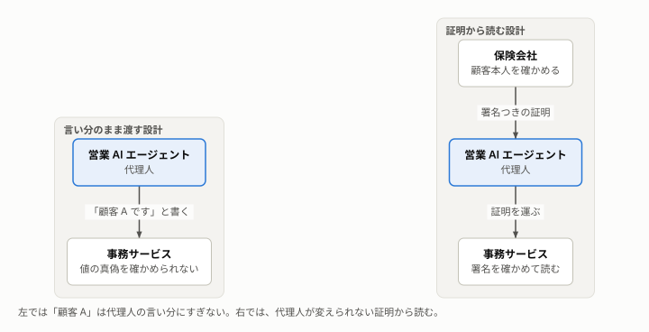

# AI が営業員を担う構成では、取引のときにトークン・署名・登録で検証し、事後に直送と監査で確かめる

窓口の統制（[題材と従来の仕組み](domain.md)）を、AI エージェントが営業員の役を担う多段呼び出しで実現する。その構成と、採用した標準仕様、窓口との対応を、2 つの時点と 3 つの確認ごとに示す。

**この文書の読み手:** 実装や設計をする人、設計を判断する人。OAuth と JWT の基本を知っている。読んだ後に、取引のときと事後のそれぞれで、どの仕様で何を担うか、窓口より劣る点と前提を説明できる。アクセストークン（権限を渡した証拠となる、署名つきのデータ）を、以下トークンと呼ぶ。**（仮称）** は、この設計での呼び名で、標準の用語ではない。3 つの確認の考え方は[目的と題材の理由](purpose.md)、用語は[用語集](glossary.md)、根拠は[ナレッジの事実の索引](knowledge/README.md#事実の索引)の項目番号（I-A1、F-G1 など）にある。

## 要旨
- **構成:** 顧客のアプリ、営業員（AI）、MCP、認可サーバー、バックエンドの 5 サービスが、窓口の役に対応する。AI は案を選び、運ぶが、案の中身と顧客の署名は作れない。
- **取引のときの検証:** バックエンドと MCP が検証する。誰の依頼かは、本人確認の記録と委任（`sub` は本人、`act` は AI）で確かめる。内容は、利用者の鍵による 2 段の署名の連鎖で確かめる。権限は、AI の登録、委任の範囲（RAR）、宛先の検証で確かめる。トークンを発行する側も、宛先を絞り、短命にし、範囲を広げさせない。
- **事後の確認と監査:** 保険会社が AI を通さずに契約内容を直接送り、顧客のアプリが写しと照合する。操作の記録と、指示とモデルの変更を監査する。
- **窓口との比較:** 機械で毎回確かめられる統制は、窓口と同等以上にできる見込みがある。人が状況を読んで止める統制は、下回る。評価は推定を含む。
- **方式の選択:** 守る相手が中継者（AI）なら、利用者の端末が署名する方式だけが効く（推定）。mTLS や、AI・MCP による署名では、書き換えた本人が正規の送信者になり、防げない。

## 1. 構成は 5 つのサービスで、窓口の役に 1 対 1 で対応する
5 つのサービスは、1 つのリポジトリの別のプロセスとして動く。構成の細部は[実装](implementation.md)にある。

| サービス | 窓口の役 | 担うこと | ポート |
|---|---|---|---|
| customer-app | 顧客 | 案を表示し、利用者の鍵（passkey）で署名する。写しを保存し、直送された契約内容と照合する | 4000 |
| sales-agent | 営業員（営業 AI エージェント） | 顧客の意向を聞き、案を選んで示し、署名済みの申込みを運ぶ。AI（Claude）が担う | 4002 |
| insurer-mcp | 事務担当（事務サービスの受付） | AI が呼ぶ窓口。自分宛てのトークンだけを受け付け、次の宛先のトークンに替えて、バックエンドを呼ぶ | 4003 |
| insurer-auth | 保険会社の認可 | 営業員を登録し、トークンを発行し、回付のたびにトークンを替える。登録の有効性の問い合わせに答える | 4001 |
| insurer-backend | 事務担当（事務サービスの点検）と、保険会社のシステム | トークンと署名の連鎖を検証し、契約の記録を作り、契約内容を顧客のアプリへ直接送る | 4004 |

流れは、窓口の 10 段（[題材と従来の仕組み](domain.md)の 1 章）に合わせた 10 段である。

1. **本人確認:** 保険会社が登録時に本人確認を行い、方法・日時・根拠を添えた確認済みの属性を持つ。顧客の鍵を、その属性に結び付けて登録する。
2. **営業員の登録:** AI をクライアントとして登録し、扱える商品と範囲を結び付ける。顧客のアプリは、保険会社が署名した登録情報（仮称）から、AI の名称、所属、扱える範囲を示す。
3. **委任:** 顧客が認可サーバーで、AI への委任の範囲（契約の種類、上限）を承認する。
4. **提示:** AI が顧客の意向を保険会社の見積の仕組みに渡し、保険会社が署名した複数の案と、提示集合の識別子（仮称）を受け取る。この段に、顧客の署名は要らない。
5. **表示:** アプリが、署名つきの案そのものから画面を描く。AI の推奨と理由は、案とは区別して表示する。
6. **意向確認:** 顧客が 1 案を選び、意向確認書面の内容を確認して署名する。署名の対象は、選んだ案、提示集合の識別子、意向の値である。
7. **申込み:** 顧客が申込内容を確認して署名する。署名の対象は、申込内容と、意向確認の署名の値である。被保険者が別人なら、被保険者が自分の端末で同意の署名をする。告知は、AI を経由しない経路で、本人が入力して署名する。
8. **回付:** AI が署名済みの申込みを、MCP 経由で保険会社の側へ回す。回付で `sub` は本人、`act` は AI になる。
9. **検証と記録:** バックエンドが、トークン、確認済みの属性、登録の有効性と範囲、署名の連鎖、被保険者の署名、`nonce` を検証する。契約の記録は、人も AI も入力せず、署名済み申込から決定論的に導出する。
10. **直送と照合:** 保険会社が契約内容を、AI を経由せず、本人確認で確かめた経路へ直接送る。アプリが写しと自動で照合し、不一致なら保険会社へ直接通報する。

1〜9 段が取引のとき、10 段と、記録の保存・監査が事後である。どの段でも、AI は内容を書き換えられる。書き換えは、9 の検証で見つかり、見逃しても 10 の照合で見つかる。利用者の鍵が端末から出ない前提で、AI は顧客の署名を作れない。

## 2. 準拠した標準仕様は、トークン・委任・署名・登録の 4 領域である
確認度は、事実集で一次資料の本文を確認したかを示す。確認できていない部分は、依拠する前に仕様の本文を読む。

| 領域 | 仕様 | 何に使うか | 根拠と確認度 |
|---|---|---|---|
| トークン | JWT（RFC 7519）、アクセストークン（RFC 9068）、JWT の実装指針（RFC 8725） | トークンの項目と、受け取る側の検証。`typ`、`aud`、`exp` を必須にする | F-G13、F-G14、F-G15。本文確認 |
| トークン | MCP の認可仕様、リソース指定（RFC 8707） | 宛先の検証と、素通しの禁止。`resource` で宛先を指定する | F-G17、F-G18。本文確認 |
| 委任 | token exchange（RFC 8693） | 回付のたびに、宛先を絞ったトークンへ替える。本人は `sub`、経由は `act` に残る | F-G1。本文確認 |
| 委任 | RAR（RFC 9396）、追加認証（RFC 9470） | 契約の種類と上限を表す。取引に応じて認証の強さを求める | F-G2、F-G3。本文確認 |
| 署名 | passkey（WebAuthn）、JCS（RFC 8785） | 内容を正規化したハッシュに、利用者の鍵で署名する | F-G20 は本文確認。WebAuthn は読んだ範囲で、取引内容を認証器の画面に出す仕組みを確認できず（F-G8） |
| 登録 | クライアント登録（RFC 7591）、有効性の問い合わせ（RFC 7662）、失効（RFC 7009） | 営業員（AI）の登録と、申込みのたびの有効性の確認、失効 | F-G12、F-G9、F-G10。本文確認 |
| 本人確認 | OpenID Connect for Identity Assurance | 本人確認の方法・日時・根拠を、確認済みの属性に添える | F-G11。本文確認 |

次の仕様は、比べて採らなかった（[5 章](#5-方式は守る相手が-ai-なら利用者の鍵での署名だけが効くので選んだ)）。DPoP（RFC 9449）と mTLS（RFC 8705）は盗用に効くが、書き換えは防げない。HTTP メッセージの署名（RFC 9421）は、中継者が通信を作り直すと検証に失敗する。SPC は、決済に特化し、仕様が確定していない。JWS（RFC 7515）と検証可能な資格情報は、未確認である。

## 3. 窓口の確認は、取引のときの検証と、事後の確認・監査に分けて、署名・委任・登録・直送に対応づく
[題材と従来の仕組み](domain.md)と同じく、取引のときの検証、事後の確認と監査、確かめきれない部分を補う、の順に示す。各時点の中は、誰の依頼か、内容は依頼どおりか、権限の範囲内か、の順に並べる。窓口になかった危険は、崩す確認の表に「（窓口になし）」と書いて入れる。

評価は、窓口が実現したかった目的を、機械の手段がどれだけ確実に実現できるかで示す。**上回る**は、窓口が人の目や技能に頼る目的を、機械が毎回実現できること。**同等**は、同じ程度に実現できること。**下回る**は、実現しきれない部分が残ること。**新しい統制**は、窓口に対応する統制がないもの。窓口の実績は、公開資料で分からないことが多く、基準にしない。評価は推定を含む。

「確かめる問い」の列は、設計を判断する人が、設計の説明に抜けがないかを問うための、はい・いいえの問いである。

### 3-1. 取引のときは、バックエンドと MCP が、トークン、署名、登録を検証する
#### 誰の依頼か
| 窓口の確認 | この構成での仕組み | 評価 | 確かめる問い | シナリオ |
|---|---|---|---|---|
| 本人確認書類による確認と記録（I-B6） | 保険会社が本人確認を行い、確認済みの属性を署名つきで持つ。属性の主体と、申込みの署名の鍵の持ち主が同じことを検証する | 上回る（推定） | 本人確認が済んだことを、営業員の申告でなく、保険会社の記録で確かめるか | 6 |
| 被保険者の同意（I-B7） | 被保険者自身が、自分の端末で内容を見て署名する | 上回る（推定） | 別人が被保険者なら、被保険者自身の署名があるか | 7 |
| （窓口になし）本人の消失 | 委任でトークンを替え、`sub` を本人のまま残し、`act` に AI を残す（F-G1）。「誰の契約か」はトークンの `sub` から決め、ツールの引数で受け取らない | 新しい統制 | 最後のサービスは、顧客本人と、経由した営業員（AI）を判定できるか | 1 |
| （窓口になし）トークンの偽造、盗用、取り違え | 署名、`alg` の固定、`iss`、`exp`、`typ` を検証する（F-G13〜F-G15）。盗用には DPoP、mTLS の併用が候補（F-G4、F-G5） | 新しい統制 | 偽造したトークン、期限切れのトークン、別の用途のトークンを拒否するか | 2、3、4、5 |
| 対象物の所有などの適格（I-X1） | 未調査 | 保留 | — | — |

窓口では、会社が持つのは、営業員が運んできた本人確認の記録と申込書だけである。その記録が本物か、営業員が本人から受け取ったものかは、書類だけでは確かめにくい（推定）。この構成では、利用者が認可サーバーに直接ログインし、委任の範囲を自分で承認する。認可サーバーは、確認済みの属性と委任の結果を載せたトークンに、保険会社の鍵で署名して発行する（F-G1、F-G11）。AI は、トークンを運ぶだけで、偽造できない。バックエンドは、届いたトークンの署名と内容を、毎回機械で検証する。この点で、窓口より上回る見込みがある（推定）。ただし、上回るのは、発行と検証を正しく行った場合に限られる（4 章）。

[目的と題材の理由](purpose.md)の 5 章の例（「顧客 A の申込みです」）に当てはめると、次のとおりである。

- **してはならない設計:** 「誰の契約か」を、AI が MCP のツールを呼ぶときの引数や、MCP がバックエンドを呼ぶときのパラメータで渡す（悪い実装の `on_behalf_of`、`for_user`。シナリオ 1）。値は AI の言い分でしかなく、バックエンドは真偽を確かめられない。バックエンドが、受け取った値で本人確認の記録を引いても、AI がその顧客に頼まれたことの確認にはならない。
- **採った設計:** 「誰の契約か」は、トークンの `sub` から決める。AI と MCP は、回付のたびにトークンを替えてもらう（token exchange）。替えたトークンでも、`sub` は本人のまま残り、`act` に経由した AI と MCP が積まれる（F-G1）。本人確認が済んだことも、AI の申告でなく、トークンの確認済みの属性から読む（シナリオ 6）。
- **事後:** バックエンドは、契約内容を、AI を通さずに顧客のアプリへ直接送り、アプリが写しと照合する（3-2）。

#### 内容は依頼どおりか
| 窓口の確認 | この構成での仕組み | 評価 | 確かめる問い | シナリオ |
|---|---|---|---|---|
| 示した案の完全性（I-A2） | 保険会社が案に署名し、AI は選別と説明だけを担う。案の全体から計算した提示集合の識別子（仮称）を、署名の対象に含める | 上回る | 示していない案や、書き換えた案で、申し込めないか | 9 |
| 推奨の理由の説明、誘導の禁止（I-A2、I-F1） | 全案をいつでも見られるようにする。指示を監査し、利益情報を指示に入れない。不審な傾向は人の窓口へ引き継ぐ | 同等（推定） | 顧客は、AI が絞り込む前の全案を見られるか | — |
| 意向の把握と確認（I-B2、I-B5） | 意向確認の署名（選んだ案、提示集合の識別子、意向の値）。法令上は求められないが、紛争への備えとして置く | 同等 | 署名を意向確認と申込みの 2 段に置き、つなげているか | 10 |
| 申込内容の確認、訂正の防止（I-A1、I-A4） | 内容を JCS で正規化したハッシュを、passkey の challenge にして署名する。申込みの署名が、意向確認の署名の値を含む。署名済み申込の写しを、顧客のアプリが保存する | 上回る | 申込みの内容が、署名したときのままかを、毎回確かめるか | 8、10 |
| 契約概要と注意喚起情報、了知（I-C1） | 表示と確認操作を記録する | 同等 | — | — |
| 確認画面（I-A1） | 確認画面を、署名する内容そのものから作る。AI の説明文から作らない。画面の信頼は、アプリの実装に依存する（F-G8） | 同等（推定） | 顧客に見せる確認画面は、AI の出力と切り離されているか | 画面の回 |
| 告知は本人が書面で（I-B3） | AI を経由しない入力経路で、本人が入力して署名する | 上回る（推定） | 告知の入力は、AI を通らない画面か | — |
| 代筆の統制（I-B1） | 作成者が `act` に残り、本人の署名が確認の証拠になる | 上回る見込み（推定） | — | — |
| 保険料の領収と精算（I-G3） | 払込は AI を経由しない経路にし、領収を記録する | 同等 | — | — |
| 事務センターの点検と記録の作成（窓口の運用は確認できず、I-D2） | 署名済み申込を正本とし、決定論的なプログラムで契約の記録を導出する。取り込みも署名の連鎖を検証する | 上回る（推定） | 契約の記録は、人も AI も入力し直さずに作られるか | 11 |
| （窓口になし）署名済みの依頼の再利用 | `nonce` が未使用で、期限内であることを確かめる | 新しい統制 | 署名済みの申込みを、二度出せないか | 12 |
| （窓口になし）AI への指示の混入 | 書き換えは署名の検証で見つかる。作成と承認を分け、委任の範囲で被害を限る | 新しい統制 | 乗っ取られた AI が書き換えても、検証で拒否するか | 8 |

#### 権限の範囲内か
| 窓口の確認 | この構成での仕組み | 評価 | 確かめる問い | シナリオ |
|---|---|---|---|---|
| 営業員の登録と名乗り、名簿との照合（I-B8、I-D3） | AI をクライアントとして登録する。名乗りは、保険会社が署名した登録情報（仮称）から表示する。申込みのたびに登録の有効性を問い合わせ（F-G9）、失効を反映する（F-G10） | 上回る（推定） | 営業員（AI）は会社に登録され、登録が外れた後の申込みを受け付けないか | 19 |
| 扱える商品と範囲（I-B8） | 委任の範囲を RAR の `authorization_details` で表し、範囲外を拒否する（F-G2） | 上回る | 扱える商品や金額を超える申込みを、拒否するか | 13、14 |
| （窓口になし）宛先違いのトークン | `aud` を検証する。`resource` で宛先を指定させる（F-G17、F-G18） | 新しい統制 | 各サービスは、自分宛てのトークンだけを受け付けるか | 15、16、17 |
| （窓口になし）トークンの素通し | 窓口ごとに、トークンを替える（token exchange） | 新しい統制 | 受け取ったトークンを、そのまま次のサービスへ渡していないか | 16、17 |
| （窓口になし）発行側の不備 | `aud` を 1 つの窓口に絞り、短命にし、回付で範囲を広げさせない | 新しい統制 | トークンの発行側は、宛先・期間・範囲を絞っているか | 14、18、21 |

### 3-2. 事後は、顧客のアプリと監査が、直接届く契約内容と、残した記録で確かめる
#### 誰の依頼か
| 窓口の確認 | この構成での仕組み | 評価 | 確かめる問い | シナリオ |
|---|---|---|---|---|
| 証券の郵送と、返戻の有無（I-G2） | 契約内容を、本人確認で確かめた経路だけに送る。届かないことも記録する | 同等 | 通知先は、営業員が書いた連絡先でないか | 20 |

#### 内容は依頼どおりか
| 窓口の確認 | この構成での仕組み | 評価 | 確かめる問い | シナリオ |
|---|---|---|---|---|
| 証券の直送と、顧客による照合（I-G2、I-A1） | AI を経由せず、顧客の登録経路へ直接送る。アプリが、保存した写しと自動で照合し、不一致や未着なら保険会社へ直接通報する | 上回る | 事後の確認は、AI を通らない経路か | 11、20 |
| クーリング・オフ（I-E1） | 取消の窓口を、AI から分け、本人から保険会社へ直接届く経路にする | 同等 | — | — |

#### 権限の範囲内か（と取引の全体）
| 窓口の確認 | この構成での仕組み | 評価 | 確かめる問い | シナリオ |
|---|---|---|---|---|
| 教育、代理店の監査、不祥事件の届出（I-F1、I-F3） | 操作ログを監査する。指示とモデルの変更の管理が、教育に当たる | 同等 | AI の指示と、その変更の履歴を、監査できるか | — |
| 面談の記録と保存（I-G1） | 署名済み申込、提示集合、`act` の連鎖、対話ログを保存する。範囲と期間は別に決める | 上回る | 揉めたとき、何に署名し、誰が取り次いだかを示せるか | 基本の流れ |

### 3-3. 確かめきれない部分を補う
| 窓口の確認 | この構成での仕組み | 評価 | 確かめる問い | シナリオ |
|---|---|---|---|---|
| 異常の検知、窓口の声かけ（C-2） | 不審な取引の検知、追加認証、別端末での確認、人の窓口への引き継ぎ | 下回る | 状況を読んで止める統制を、人の窓口に引き継げるか | — |
| 高齢者の募集の措置（I-B9） | 対象外。対象は自分でアプリを操作できる顧客に限り、それ以外は対面の窓口で扱う | 対象外 | — | — |
| 加入の査定（I-D1） | 保険会社の側の審査。AI を経由しない | 同等 | — | — |
| 所属会社の賠償責任（I-H1） | 技術では決まらない | 対象外 | — | — |

## 4. 取引のときの検証項目は、受け取る側・申込み・AI と MCP・発行する側に分かれる
実装は、トークンの検証が [tickets.ts](../packages/shared/src/tickets.ts) と [verify/ticket.ts](../packages/insurer-backend/src/verify/ticket.ts)、申込みの検証が [app.ts](../packages/insurer-backend/src/app.ts)、発行が [issuer.ts](../packages/insurer-auth/src/issuer.ts) と [server.ts](../packages/insurer-auth/src/server.ts) にある。「シナリオ」の列は、[scenarios.md](scenarios.md) の番号である。scenarios.md の防御の一覧（D1〜D20）は、この章の項目に対応する。「—」は、再現するテストがない項目で、設計上の確認項目として残る。

### 4-1. 受け取る側が確かめるトークンの項目
受け取る側は、バックエンドと、AI が呼ぶ MCP である。`iss`、`sub`、`aud`、`exp`、`typ` は、JWT の基本仕様では任意で、アクセストークンの規則が必須にする（F-G13、F-G15）。実装は、アクセストークンの規則に合わせる。

| 項目 | 確かめ方 | 省くと起きること | 根拠 | シナリオ |
|---|---|---|---|---|
| 署名 | 発行元の公開鍵で検証する。許可する `alg` を固定し、`none` を拒否する | 偽造したトークンや、署名のないトークンが通る | F-G13、F-G14、F-G15 | 2、3 |
| `iss` | 想定する発行元と完全に一致する | 別の発行元が出したトークンが通る | F-G14、F-G15 | — |
| `aud` | 自分を識別する値を含む。含まなければ拒否する | 営業員宛てのトークンで、会社の事務が申込みを受け付ける | F-G13、F-G14、F-G15、F-G17 | 15、16、17 |
| `exp` | 現在時刻より前。教材の実装は、時計のずれの猶予を置かない | 盗まれたトークンが、使い続けられる | F-G13、F-G15 | 4 |
| `typ` | `at+jwt` を確かめる。違えば拒否する | 別の用途のトークン（本人確認用のトークンなど）が、アクセス用として通る | F-G14、F-G15 | 5 |
| `sub` | アプリケーションで有効な主体に対応させる。操作の対象とも一致させる | 他人の契約を操作される | F-G14、F-G15 | 1 |
| `scope` | `aud` のリソースで意味を持つ値だけを、認可の判断に使う | 権限のない操作が通る | F-G15 | — |
| 範囲（RAR） | 契約の種類や上限が、`authorization_details` の範囲内である | 営業員（AI）が扱えない商品や金額の申込みが通る | F-G2、D-3 | 13 |
| `act` | 経由した窓口の連鎖を、記録に残す | 誰が取り次いだかが、追えない | F-G1、D-2 | 21 |

### 4-2. バックエンドが確かめる申込みの項目
トークンの検証では分からない、内容の正しさを確かめる。この項目は、設計上の確認項目で、仕様や窓口の要求そのものではない。

| 項目 | 確かめ方 | 省くと起きること | 根拠 | シナリオ |
|---|---|---|---|---|
| 署名の連鎖 | 意向確認と申込みの 2 つの署名を検証する。申込みの署名が、意向確認の署名の値を含む | 意向確認から申込みの間で、内容をすり替えられる | [P-2](knowledge/decisions/P-2.md) | 8、10 |
| 内容の一致 | 提出された内容を JCS で正規化したハッシュが、署名した `challenge` と一致する | 署名のあとで、案や金額を書き換えられる | F-G20、F-G8 | 8 |
| 案の整合 | 選ばれた案が、署名された提示集合に含まれ、保険会社の署名が有効である | 示していない案や、書き換えた案で申し込める | [P-1](knowledge/decisions/P-1.md) | 9 |
| 再利用 | `nonce` が未使用で、期限内である | 署名済みの申込みを、二度出される | 1 章の 9 段 | 12 |
| 被保険者の署名 | 別人が被保険者なら、被保険者自身の署名がある | 無断で他人を被保険者にした契約が通る | I-B7 | 7 |
| 本人確認の属性 | トークンに確認済みの属性（方法、日時）がある。属性はトークンの `sub` に結び付き、署名の鍵も `sub` のものを使う | 営業員の申告だけで、本人確認が済む。別人の確認を流用される | F-G11、F-G3 | 6 |
| 営業員（AI）の登録 | トークンを取った窓口と `act` の連鎖の全てが、登録済みで有効かを、認可サーバーに問い合わせる。応答をキャッシュするなら、失効の許容時間に合わせる | 登録が失効した営業員（AI）の申込みが通る | F-G9、F-G10 | 19 |
| 記録の導出 | 契約の記録は、署名済み申込から決定論的に導出する | 申し込まれた内容と違う契約が記録される | [P-16](knowledge/decisions/P-16.md)、P-16 | 11 |
| 記録 | 署名済みの申込み、提示集合、`act` の連鎖を保存する | 揉めたとき、何に署名したかを示せない | I-G1、D-9 | 基本の流れ |

### 4-3. 営業員（AI）と MCP が気をつける項目
| 項目 | 確かめ方 | 省くと起きること | 根拠 | シナリオ |
|---|---|---|---|---|
| トークンを素通ししない | 受け取ったトークンを、次の宛先へそのまま流さない。次の宛先のトークンに、替えてもらう | 営業員宛てのトークンが、会社の事務まで通る | F-G17、F-G1 | 16、17 |
| 宛先を検証する | MCP サーバーは、自分宛てでないトークンを拒否する | 他のサービス向けのトークンで、会社の事務が動く | F-G17 | 17 |
| 本人を引数から決めない | 「誰の契約か」は、トークンの `sub` から決める。ツールの引数で受け取らない | 営業員が引数で別人を指定して、申し込める | この設計の原則（推定） | 1 |
| 確認画面を内容から作る | 画面は、署名する内容そのものから描く | 顧客に見せる内容と、署名する内容がずれる | F-G8、D-5 | 画面の回 |
| トークンを URL に入れない | トークンは `Authorization` ヘッダーに入れる。クエリ文字列に入れない | トークンが記録や履歴に残り、盗まれる | F-G17 | — |

### 4-4. 発行する側が確かめる項目
受け取る側がどれだけ丁寧でも、発行側が雑だと防げない。

| 項目 | 良い発行 | 悪い発行の害 | 根拠 | シナリオ |
|---|---|---|---|---|
| `aud` | 1 つの窓口に絞る。`resource` で宛先を指定させる | どのサービスも通す万能のトークンになる | F-G18、F-G15、F-G16 | 15、18 |
| 有効期間 | 短くする | 盗まれたトークンが、長く使える | F-G15、F-G17 | 18 |
| `typ` | `at+jwt` を付ける | トークンの種類が区別できない | F-G15 | 5 |
| 取り違えの防止 | 異なる種類のトークンで、鍵、`aud`、`iss` を使い分ける | ID トークンなどが、アクセストークンとして通る | F-G14 | 5 |
| `act` | 回付のたびに積む | 経由が追えない | F-G1、D-2 | 21 |
| 範囲 | 回付で、引き継ぐか狭めるだけにする | 回付で、契約の種類や上限を広げられる | F-G2、D-3 | 14 |
| 回付の宛先 | 窓口ごとに、許可する宛先を決める | 任意の窓口宛てのトークンが取れる | F-G1、D-2 | — |
| 登録と失効 | 営業員（AI）をクライアントとして登録し、失効を反映する | 失効した営業員（AI）が、使い続ける | F-G12、F-G10 | 19 |

RFC 9700 の「token passthrough」の記述は、読んだ範囲に見つからなかった。素通しの禁止の根拠は、MCP の認可仕様である（F-G16、F-G17）。

## 5. 方式は、守る相手が AI なら、利用者の鍵での署名だけが効くので選んだ
守る相手が中継者（AI）なら、利用者の端末が署名する方式だけが効く（推定）。署名の鍵を持つのが中継者自身なら、書き換えた内容にも正しい署名が付く。署名が示すのは「誰が送ったか」であり、「本人が何を承認したか」ではない。

| 方式 | 通信路の書き換え | トークンの盗用 | 中継者（AI）の書き換え |
|---|---|---|---|
| mTLS（F-G5） | 防げる | 証明書に結んだトークンなら、防げる | 防げない（推定） |
| DPoP（F-G4） | TLS に依存する。proof の対象は HTTP メソッドと URI だけ | 鍵を持たない第三者の再利用を防げる | 防げない |
| AI や MCP による HTTP の署名（F-G19） | 署名した構成要素については、防げる | 別の仕組みが要る | 防げない（推定） |
| 利用者の端末による署名（JWS、WebAuthn） | 防げる | 別の仕組みが要る | 防げる（鍵が端末から出ない前提） |

RFC 9421 は、中継者が通信を作り直して署名の対象を書き直すと、検証に失敗する（F-G19）。MCP は、バックエンドへ新しい要求を作る。そのため、AI から MCP への署名は、バックエンドまでは届かない（推定）。

採った方式の手順は、次のとおり。実装は、[canonical.ts](../packages/shared/src/canonical.ts)（正規化とハッシュ）、[seal.ts](../packages/insurer-backend/src/verify/seal.ts)（署名の検証）、[app.ts](../packages/insurer-backend/src/app.ts)（2 段の連鎖）にある。
1. 署名する内容を JCS で正規化し、SHA-256 を取る。意向確認の内容は、選んだ案、案の全体の識別子、意向の値。申込みの内容は、申込内容と、意向確認の署名の値。
2. 顧客のアプリが、そのハッシュを challenge にして、passkey で署名させる。
3. バックエンドが、登録された公開鍵で署名を検証し、challenge と内容のハッシュが一致することを確かめる。

主な判断と、退けた案は、次のとおり。全ての判断は[ナレッジの判断の索引](knowledge/README.md#判断の索引)にある。

| 判断 | 退けた案 | 理由 | 悪い面 |
|---|---|---|---|
| D-1. 取引内容の承認は、利用者の鍵による署名で行う | mTLS だけ。AI や MCP による署名。取引ごとのトークン発行 | 通信路の保護と中継者の署名は、中継者が正規の送信者のとき、書き換えを防げない（F-G4、F-G5） | 署名前の確認画面の信頼に依存する（F-G8） |
| D-2. AI の動作は、token exchange の委任で表し、成り代わりにしない | AI の資格での呼び出し。本人のトークンの流用 | 委任では、本人と行為者の両方がトークンに残る（F-G1） | 発行側が `act` を付けなければ効かない |
| D-5. 確認画面は、署名する内容そのものから作る | AI の説明文を表示する | 画面と署名の内容が一致する保証が要る（F-G8） | アプリの実装に依存する |
| P-1. 示す案の中身は、保険会社が署名する。AI は選別と説明だけ | AI が案を生成して示す。AI が署名する | 案の書き換えは、顧客の誤認につながる（推定） | 保険会社の見積の仕組みが要る |
| P-2. 署名を意向確認と申込みの 2 段に置き、連鎖させる | 申込みの 1 回だけ署名する。提示にも署名する | 段の間のすり替えを検出できる（I-B5） | 署名が 2 回になり、手間と実装が増える |
| P-8. 契約内容は、AI を経由しない経路で直接送り、アプリが自動で照合する | AI が受け取って顧客に渡す。確認を顧客の目視だけに任せる | AI が間にいる構成では、AI を通らない確認経路が要る（I-G2、推定） | アプリを開かなければ照合が起きない |
| P-16. 契約の記録は、署名済み申込から決定論的に導出する | 人の再入力と二次入力。AI による入力 | 窓口の実態は確認できず（I-D2）。1 人の誤りや不正で取引が完了しない目的に照らす | プログラムと保管庫の変更管理が、新しい重要な統制になる |

退けた方式は、次のとおり。

| 案 | 退けた理由 | 残るトレードオフ |
|---|---|---|
| 取引ごとにトークンを発行（RAR） | 取引ごとに承認と発行が要り、発行回数が増える（推定） | RAR は権限の範囲（契約の種類、上限）に使い、取引ごとには使わない（F-G2） |
| AI や MCP による HTTP の署名（RFC 9421） | 署名者が書き換えた張本人なら防げない。MCP が要求を作り直すと、署名が切れる（F-G19） | 窓口間の通信の保護には使える（推定） |
| Secure Payment Confirmation（W3C） | 取引内容をブラウザの画面に出せるが、決済に特化し、仕様は Candidate Recommendation Draft（F-G7） | 仕様が確定すれば、画面の信頼を改善できる |

## 6. 機械で確かめられない部分と、未確認の仕様が残る
- **人が状況を読んで止める統制は、下回る:** 窓口の声かけ（C-2）と、意思能力が弱い本人の場合である。詐欺の指示を受けた本人の操作も残る。補う方法は、検知、追加認証、別端末での確認、人の窓口への引き継ぎで、設計の対象外の運用に依存する。
- **対象は、自分でアプリを操作できる顧客に限る:** 高齢者の募集の措置（I-B9）は、人が様子を見る統制なので、対面の窓口で扱う。本人しかログインできない設計で、家族の代理操作は減らせる見込みがあるが、意思能力が弱い人は残る（[P-15](knowledge/decisions/P-15.md)）。
- **署名前の画面の信頼:** 署名する内容と画面の表示が一致する保証は、アプリの実装に依存する。passkey の画面が取引内容を出す仕組みは、読んだ範囲で確認できなかった。仕様の約 2 割しか読んでおらず、「ない」とは言えない（F-G8）。
- **署名は、押す前の判断を保証しない:** 利用者が内容を読まずに押せば、検出できない。
- **第三者の情報の強さ:** 本人確認の記録と登録の記録が正しいことが前提である。登録時の本人確認の強さと、確認の鮮度の基準は未決である。全体の強さは、登録の強さで決まる。
- **事務点検と、営業員の確認:** 窓口の運用が確認できなかった（I-D2、I-D3）。設計の評価は、目的に照らして行い、一部は推定である。
- **直送の経路:** 送り先が、本人が登録した経路であることが前提である。アプリを開かなければ、照合は起きない。経路が乗っ取られると、確認は成立しない。
- **未確認の仕様:** JWS、検証可能な資格情報は未確認である。RFC 9421 は先頭の約 4 割、SPC は約半分だけを読んだ。FAPI 2.0 の署名と JAR（RFC 9101）は比べていない。
- **未調査の統制:** 消費者契約法、使用者責任、保険業法の条文、営業員の身分証、対象物の所有者の確認は調べていない（I-X1）。法令や業界基準への適合は、扱っていない。

## 7. 設計の説明で抜けやすいのは、内容の確認、発行側、AI を通らない経路である
設計の説明を判断するときに、抜けやすい点を挙げる。3 章の「確かめる問い」で、1 つずつ確かめる。
- **トークンの検証の中身がない:** 「トークンを検証している」とだけ書かれ、検証する項目（署名、発行元、宛先、期限、種類）がない（4-1）。
- **受け取る側だけを説明している:** 発行側の絞り込み（宛先、期間、範囲）がない（4-4）。発行側が雑だと、受け取る側の検証では補えない。
- **AI への指示を、対策にしている:** 「AI に注意させる」「プロンプトで禁じる」を、書き換えや権限の超過への対策としている。指示は、外から混ぜ込まれた入力で上書きされうる（推定）。内容は署名で、範囲は登録と委任の範囲で確かめる（3-1）。
- **通信路の保護を、内容の確認と取り違えている:** 「サービス間は mTLS で保護している」を、書き換えへの対策としている。通信路は守れるが、正規の送信者である AI の書き換えは防げない（推定。5 章）。
- **事後の確認が、AI を通る:** 契約内容を AI が受け取って顧客に渡す設計では、運ぶ途中の書き換えを顧客が見つけられない（3-2）。

動くもので確かめるときは、次の方法を使う。
- 宛先、素通し、本人の消失、トークンの偽造、内容の書き換えは、攻撃の再現テストで確かめる。[scenarios.md](scenarios.md) が、観点の見本になる。
- 確認画面は、悪意ある説明文を AI に出させて、画面に反映されないことを見る。
- 発行側は、実際に発行されたトークンを 1 通もらい、宛先・有効期間・範囲を読み合わせる。
