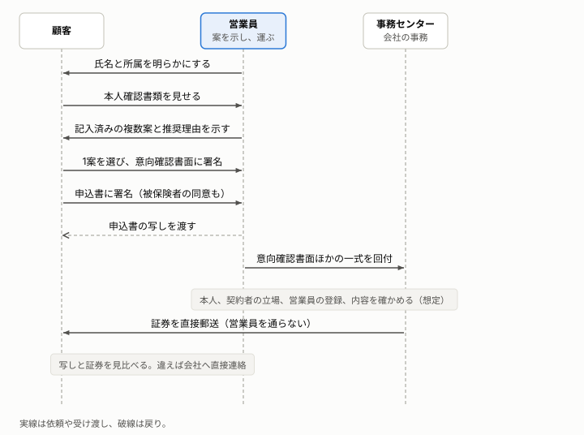

# 保険の募集は、営業員の言い分を、書類・記録・会社からの直送という第三者の情報と突き合わせて、選ぶことを本人のものにしている

保険の窓口で、営業員が複数の案を示し、顧客が選んで申し込む場面について、従来の統制と、その統制が実現したいことを説明する。

**この文書の読み手:** OAuth や passkey などの専門用語を知らない人。立場は問わない。保険の実務も知らなくてよい。読んだ後に、営業員の言い分を第三者の情報と突き合わせて確かめる仕組みを、防ぐ対象ごとに説明できる。この文書に、デジタルの言葉は出てこない。仕様との対応は[アーキテクチャ](architecture.md)にある。用語は[用語集](glossary.md)、根拠は[事実集](research/findings.md)の項目番号（I-A1 など）にある。

## 要旨
- **営業員の言い分を、第三者の情報と照らす 4 段がある:** 推奨の理由の説明（I-A2）、意向確認書面（I-B2）、申込書の写し（I-A1）、証券の直送と照合（I-G2）。この 4 段の整理は、資料にない（推定）。
- **統制は 19 の型に整理できる:** 「営業員は正当か」など 5 つの問いに分けられる。どれも、「当事者の言い分を、記録や第三者の目で確かめる」ことで成り立つ。
- **営業員が書類を運んでも、会社が 4 つを確かめる:** 誰が申し込んだか、誰のための契約か、どの権限の営業員か、内容が署名したときのままか（想定を含む）。
- **弱い点は、人の注意に頼る部分である:** 推奨の偏り、顧客が写しを読むこと、事務担当の点検である。
- **確認できなかった運用がある:** 事務センターの点検や、営業員の確認の方法は、公開資料にない。想定として区別する。

## 1. 登場人物は 4 者で、流れは 10 段である
顧客は、保険に申し込む人である。営業員は、顧客の相談に乗り、案を示し、申込書を運ぶ。事務センターは、会社の事務を担い、回付された一式を点検する。保険会社は、営業員を登録し、案を作り、証券を発行する。

| 段 | 何が起きるか | 根拠 |
|---|---|---|
| 1. 名乗り | 営業員が、氏名と所属を明らかにする。取り扱える保険会社の範囲を説明する | I-B8 |
| 2. 本人確認 | 営業員が、本人確認書類の原本で、顧客の氏名・住居・生年月日を確かめ、確認記録を作る | I-B6 |
| 3. 相談 | 営業員が、希望や事情を聞く。誰のための契約か（被保険者、対象物）を確かめる | I-B2、I-B7 |
| 4. 提示 | 営業員が、記入済みの複数案を設計書と比較表で示す。推奨する案には理由を説明する。手数料で誘導しない。この段に、顧客の署名は要らない | I-A2、I-B5。記入の運用は想定 |
| 5. 意向確認 | 顧客が 1 案を選び、意向確認書面で、自分の意向と案が合うことを確かめて署名する | I-B2、I-B5 |
| 6. 申込み | 顧客が申込書に署名する。告知は、本人が書面で行う。被保険者が別人なら、被保険者も同意の署名をする。顧客は、申込書の写しを受け取る。保険料は、会社へ直接払うか、会社所定の領収証を受け取る | I-B3、I-B7、I-A1、I-G3 |
| 7. 回付 | 営業員が、意向確認書面、申込書、確認記録と書類の写し、被保険者の同意、登録番号を一式にして、事務センターへ回す | 一式の中身と運用は想定 |
| 8. 点検 | 事務担当が、一式を確かめ（[3 章](#3-営業員が書類を運んでも会社が確かめる-4-つと最後の確認がある)）、会社が加入を査定する | I-D1。点検は想定 |
| 9. 直送 | 事務センターが、営業員を通さずに、本人確認済みの住所へ証券を郵送する | I-G2。営業員への適用と住所の確認は想定 |
| 10. 照合 | 顧客が、手元の写しと証券を見比べる。違えば、営業員を通さずに、会社へ直接連絡する | I-G2 |

## 2. 統制は、当事者の言い分を、記録や第三者の目で確かめる 19 の型である
統制は、防ぐ対象ごとに分けると 19 の型になる。「防ぐ対象」は、窓口が実現したかった目的である。規則の文言や制度の趣旨から読み取れる。実際にどれだけ実現できていたかは、公開資料では分からないことが多い。「当事者の言い分」の列は、統制が何と突き合わせるためにあるかを示す整理で、資料にある言葉ではない（推定）。

### 2-1. 営業員は正当か
| 統制 | 当事者の言い分 | 防ぐ対象 | 根拠 |
|---|---|---|---|
| 営業員の登録と、氏名・所属の明示 | 「営業員です」という名乗り | 資格のない者の募集、立場の誤認 | I-B8 |
| 教育、代理店の監査、不祥事件の届出 | 「不正はしていません」 | 営業員の内部不正 | I-F1、I-F3 |

### 2-2. 来た人は誰で、契約できる立場か
| 統制 | 当事者の言い分 | 防ぐ対象 | 根拠 |
|---|---|---|---|
| 本人確認書類の原本による確認と、確認の記録 | 「本人です」という口頭の申告、書類のコピー | なりすまし | I-B6 |
| 被保険者の同意 | 契約者の「本人も同意しています」 | 無断で他人を被保険者にする契約 | I-B7 |
| 申込みの後の、会社による加入の査定 | 申込書に書かれた内容 | 引受の誤り | I-D1 |

### 2-3. 提案は公正で、意向と合っているか
| 統制 | 当事者の言い分 | 防ぐ対象 | 根拠 |
|---|---|---|---|
| 比較可能な商品の概要を示し、推奨の理由を説明する | 「これが最適です」 | 恣意的な誘導 | I-A2 |
| 手数料水準で商品を誘導しない | 営業員の利益と無関係だという言葉 | 営業員の利益相反 | I-A2、I-F1 |
| 契約概要と注意喚起情報の交付、口頭の説明、了知の確認 | 「説明しました」 | 誤認 | I-C1 |
| 意向の把握と、意向確認書面の交付・保存 | 「ご希望に合っています」 | 意向とのずれ | I-B2、I-G1 |
| 告知は、本人が書面で行う | 営業員への口頭の伝達 | 口頭の聞き違い、営業員の書き換え | I-B3 |
| 高齢者の募集の措置（親族の同席、別の担当者の電話確認など） | 営業員が見た「本人の様子」 | 判断の弱い人の不利益な申込み | I-B9 |

### 2-4. 申込内容は本人が確認したか
| 統制 | 当事者の言い分 | 防ぐ対象 | 根拠 |
|---|---|---|---|
| 申込内容の確認と、申込書の写しの交付 | 「内容はこのとおりです」 | 申込内容の後出し変更 | I-A1 |
| 代筆は、複数の職員等が確認して記録する | 「顧客に頼まれて書きました」 | 代筆の悪用 | I-B1 |
| 保険料の領収証と、会社への精算 | 「保険料は預かりました」 | 保険料の着服 | I-G3 |
| 訂正の記録と、差し替え・書き足しの防止（訂正印、契印・割印、大字。保険の申込書での運用は確認できず） | 「署名のあとに直していません」 | 署名後の書き換え | I-A4 |

### 2-5. 後で確かめ、追えるか
| 統制 | 当事者の言い分 | 防ぐ対象 | 根拠 |
|---|---|---|---|
| 証券を代理店を介さずに顧客へ送り、顧客が照合する | 営業員の「契約はこのとおりです」 | 運ぶ途中の書き換え、無断の契約 | I-G2 |
| 面談の帳票と意向確認書面の保存 | 後日の「そんな説明はしていない」 | 後日の追跡 | I-G1 |
| 所属する会社が、募集人の与えた損害を賠償する | （言い分の確認ではない） | 責任の所在 | I-H1 |
| クーリング・オフ（補助） | 勧誘の場での承諾 | 勧誘への不本意な承諾 | I-E1 |

## 3. 営業員が書類を運んでも、会社が確かめる 4 つと、最後の確認がある
営業員は、自分の言葉でなく、書類で証明する。事務センターは、回付された一式で、次の 4 つを確かめる（想定）。

| 確かめること | 一式の中身 | 事務センターの確認 | 根拠 |
|---|---|---|---|
| 誰が申し込んだか（本人） | 本人確認の記録と、書類の写し | 記録が揃い、申込書の署名と同じ人かを点検する | I-B6。点検は想定 |
| 誰のための契約か（立場） | 被保険者の同意の署名。対象物の所有を示す書類 | 他人を被保険者とする死亡保険などは、同意がなければ効力が生じない。所有の確認は未調査 | I-B7、I-X1 |
| どの権限の営業員か | 氏名、所属、登録番号 | 登録が有効で、扱える範囲の申込みかを、会社の登録の記録で確かめる | I-B8、I-D3。確認は想定 |
| 内容が署名したときのままか | 顧客が署名した意向確認書面と、申込書 | 選んだ案と申込書の内容が一致するか、訂正や不審な箇所がないかを、事務担当が目で点検する。担当者の技能に頼る | I-D2。想定 |

営業員が、顧客の知らないうちに案を差し替えたり、申込書を書き換えたりしたとする。事務センターは、食い違いや訂正の跡を点検する。それでも見つからなければ、受け取った申込書のとおりに契約が結ばれ、証券が顧客へ送られる。

最後の確認は、営業員を通らない。顧客の手元には、署名したときの写しがある。証券が届くと、顧客は写しと見比べる。内容が違えば、顧客は営業員を通さずに、会社へ連絡できる。営業員は、この確認の経路を握れない。金融庁の監督指針は、不正契約の防止のため、証券の交付を、正当な理由なく代理店を介して行わない措置を求めている（I-G2、保険代理店の管理の項）。

この確認には限りがある。
- **顧客が見比べなければ、見つからない:** 写しを渡しても、顧客が読むとは限らない（推定）。
- **送り先を営業員が書けば、確認が破られる:** 送り先は、本人確認書類で確かめた住所にする。証券を郵送して返戻されないことで、実在を確かめる方法もある（I-G2）。
- **署名する前の差し替えは、この確認では分からない:** 提示した案が書き換えられていないことは、署名の前に、顧客が案を確かめる必要がある。
- **全ての契約が直送とは限らない:** 団体の契約などでは、勤務先を経由して渡す場合がある（I-G2）。

## 4. 弱い点は、人の注意や技能に頼る部分である
窓口が意図した目的を、人の注意や技能に頼って実現している点が弱い。

- **推奨の偏り:** 推奨の理由を説明し、手数料で誘導しないという規定がある（I-A2）。しかし、営業員が何を考えて案を選んだかは、説明からは分からない。監視と監査（I-F1）が頼りである（推定）。
- **申込内容の確認:** 写しを渡しても、顧客が読まなければ、食い違いは見つからない。証券が届いたときの見比べも同じである（推定。I-A1、I-G2）。
- **事務点検と回付:** 営業員の側の統制は確認できたが、会社の側の事務点検と相互牽制は確認できなかった（I-D2）。内容が署名したときのままかは、事務担当の目と技能に頼る（想定）。
- **取消の限り:** クーリング・オフは、申込日か書面の受領日の遅いほうから 8 日以内で、保険期間が 1 年以内の契約などは対象外になる。会社宛てに出す必要がある（I-E1。要約のみ）。

これらの弱い点を、機械で補う構成は、[アーキテクチャ](architecture.md)にある。

## 5. 実在する仕組みと、想定の区別
この文書の説明は、確認できた仕組みと、確認できなかった運用でできている。

| 要素 | 実在の仕組み | 確認の状況 |
|---|---|---|
| 名乗りと、氏名・所属の明示 | 営業員は、顧客に氏名を明らかにする。意向確認書面に、募集人の氏名・名称を記載する（金融庁の監督指針） | 実在（I-B8）。本文確認 |
| 本人確認書類の原本による確認と記録 | 原本で確認し、コピーの提示だけでは認めない。確認の記録を作る | 実在（I-B6）。本文確認 |
| 被保険者の同意 | 他人を被保険者とする死亡保険は、同意がなければ効力が生じない（保険法 38 条） | 実在（I-B7）。本文確認 |
| 意向確認書面、比較と推奨理由、申込書の写し | 意向の把握、推奨の理由の説明、申込書の写しの交付 | 実在（I-B2、I-A2、I-A1）。本文確認 |
| 告知は本人が書面で | 営業職員に口頭で伝えても、告知にならない | 実在（I-B3）。要約のみ |
| 保険料の領収 | 領収証を発行する。代理店が領収した保険料は区分して会社に精算する | 実在（I-G3）。本文確認 |
| 証券を、代理店を介さずに交付 | 正当な理由なく代理店を介して行わない措置を求める | 実在（I-G2）。本文確認。会社の営業員への適用は想定 |
| 営業員が記入済みの複数案を示す | 営業員が設計書を作って示す運用 | 規定は確認できず（I-A3）。想定 |
| 回付される一式の中身 | 確認記録と書類の写しを、申込書に添えて回す運用 | 確認できず（I-B6、I-D2）。想定 |
| 事務センターの点検と、営業員の確認 | 申込書の点検、営業員の登録と権限の確認 | 確認できず（I-D2、I-D3）。想定 |
| 送り先を本人確認済みの住所にする | 証券の送付先の確認 | 確認できず。想定 |

次の項目は、**調べていない**。消費者契約法による取消、使用者責任との関係、保険業法の条文の本文、営業員の身分証、損害保険の被保険利益と対象物の所有者の確認（I-X1）。確認する方法は、保険会社の事務規程、募集人向けの手引、実務経験者への聞き取りである。要約のみで確認した項目は、依拠する前に本文を読む。
