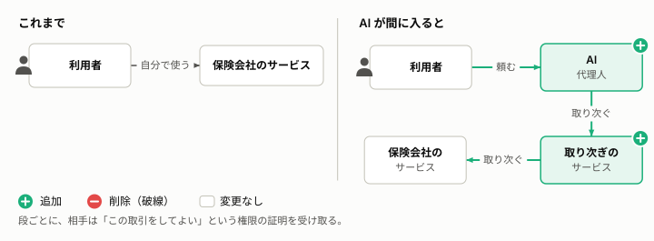
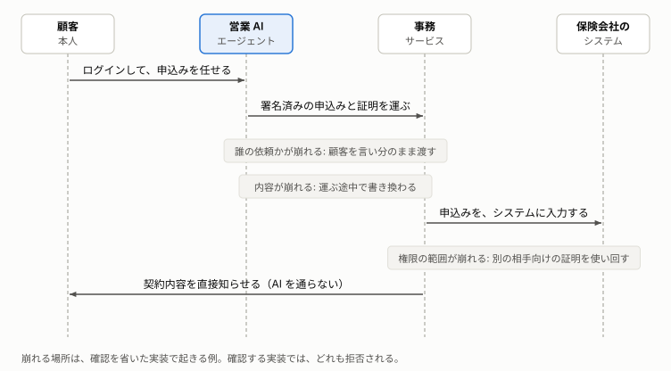

# AI に取引を任せるなら、誰の依頼か・内容は依頼どおりか・権限の範囲内かを、代理人の言い分でなく、独立した情報で確かめる

AI に取引を任せるときに何を確かめるべきか、なぜそれが崩れやすいのかを、保険の窓口の例えと図で説明する。

**この文書の読み手:** OAuth や passkey などの専門用語を知らない人。立場は問わない。読んだ後に、AI に取引を任せるときに確かめる 3 つと、それが崩れると何が起きるか、なぜ抜けやすいかを、自分の言葉で説明できる。この文書は、技術の言葉を使わない。窓口の統制の詳細は[題材と従来の仕組み](domain.md)、AI の構成での確かめ方は[アーキテクチャ](architecture.md)、用語は[用語集](glossary.md)にある。

## 要旨
- **3 つを確かめる:** 代理人が間に入る取引では、誰の依頼か、内容は依頼どおりか、権限の範囲内か、を確かめる。
- **取引のときと、事後の 2 回確かめる:** 取引のときは、代理人と取引の相手が、書類や名簿で検証する。事後は、本人が、相手から直接届いた内容で確かめ、相手が代理人を監査する。
- **独立した情報で確かめる:** 代理人の言い分だけでは、誤りも偽りも分からない。公的な本人確認書類、会社の名簿、本人自身など、代理人と独立した情報と照らす。
- **AI では崩れやすく、崩れると被害が出る:** AI が代理人になると、取り次ぎが何段にも重なる。3 つの確認が崩れると、他人の契約が見える、選んでいない契約に申し込まれる、といったことが起きる。このリポジトリの、確認を省いた実装で、実際に起きる。
- **抜けに気づきにくい:** 確認を省いても、普段の操作は同じように動く（推定）。だから、課題を理解した上で、確認を作り込む必要がある。

## 1. 保険の窓口では、営業員の言い分を、取引のときに検証し、事後にも確かめている
保険の窓口で、顧客が営業員に申込みを頼む場面を考える。営業員は、顧客の代わりに申込書を保険会社へ運ぶ。保険会社から見ると、手元に届くのは、営業員が運んできた書類と、営業員の説明だけである。

それでも、営業員の言い分は、そのまま信じられてはいない。確かめる時点は、2 つある。

- **取引のとき:** 営業員は、顧客が見せる本人確認書類で、申し込んだのが本人かを確かめ、記録を作る（I-B6）。保険会社は、営業員の名乗りを自社の営業員の名簿と照らし、運ばれた申込書を点検する。ただし、会社の側のこの確認の方法は、公開資料で確認できず、想定である（I-D2、I-D3）。
- **事後:** 保険会社は、契約が決まると、証券を営業員を通さずに顧客へ直接送る。顧客は、申込みのときに受け取った申込書の写しと、届いた証券を見比べる（I-A1、I-G2）。保険会社は、営業員を監査し、記録を保存して、後で調べられるようにする（I-F1、I-G1）。

この場面の営業員のように、本人に代わって取引を進める者を、この文書では代理人と呼ぶ。

## 2. 確かめるのは、誰の依頼か、内容は依頼どおりか、権限の範囲内か、の 3 つである
代理人が運んでくる取引には、3 つの言い分が含まれている。それぞれを、取引のときと事後に確かめる。

| 確かめること | 代理人の言い分 | 取引のときの検証 | 事後の確認と監査 |
|---|---|---|---|
| 1. 誰の依頼か | この方から頼まれた | 営業員が、顧客の見せる本人確認書類で確かめる（I-B6） | 証券を、本人確認で確かめた住所へ送る。戻ってこないことで、実在を確かめる（I-G2） |
| 2. 内容は依頼どおりか | 頼まれた内容はこのとおり | 会社が、顧客の署名した申込書と意向確認書面を突き合わせる（想定。I-D2） | 顧客が、手元の写しと届いた証券を見比べる（I-A1、I-G2） |
| 3. 権限の範囲内か | この商品を扱ってよい | 会社が、名乗りを自社の営業員の名簿と照らす（想定。I-D3） | 会社が営業員を監査し、記録を保存する（I-F1、I-G1） |

この 2 つの時点と 3 つの確認は、[題材と従来の仕組み](domain.md)、[アーキテクチャ](architecture.md)で、共通の章立てとして使う。窓口の統制の一つひとつは、題材と従来の仕組みの 2 章（取引のとき）と 3 章（事後）にある。

## 3. 言い分ではなく、独立した情報と照らすから、確かめたことになる
代理人の言い分は、代理人が誤っていても、偽っていても、同じ形で届く。言い分だけを見ていては、正しいかどうかを確かめようがない。代理人と独立した情報と照らして、初めて確かめたことになる。

窓口で照らす情報は、どれも営業員と独立している。
- **公的な本人確認書類:** 顧客が持参する。発行するのは、営業員でも会社でもない公的な機関である。
- **会社の営業員の名簿:** 会社が管理する。営業員が自分で書き換えることはできない（推定）。
- **顧客本人:** 申込書に署名し、事後に、会社から直接届いた証券を、自分の手元の写しと見比べる。

ただし、照らす情報そのものが信頼できることも要る。名簿が古かったり、本人確認書類が偽造されていたりすれば、照らしても見抜けない。

### この考え方の裏付け
- **監査:** 国際的な監査の基準は、独立した外部の情報源から得た証拠を、内部で作られた証拠より信頼できるとする（ISA 500、ISA 505。C-3）。監査人が第三者に直接問い合わせ、直接回答を得る手続を「外部確認」と呼ぶ。会社が証券を営業員を通さずに顧客へ送り、顧客が確かめる事後の確認は、外部確認と同じ形をしている（推定）。
- **法律:** 代理人の行為が本人に効力を持つのは、本人から任された範囲で、本人のためと示して行ったときである。任されていない者の行為は、本人が認めない限り、本人に効力が生じない（民法 99 条、113 条。C-5）。3 つの確認は、この考え方に、内容の一致を加えたものである（推定）。窓口の営業員が、法律上の代理に当たるかは、調べていない（[題材と従来の仕組み](domain.md)の 1 章）。
- **言葉:** この文書群は、「取引が確か」と平易に書く。情報セキュリティの用語では、主体や情報が主張どおりであることを、真正性と呼ぶ（[用語集](glossary.md)）。

## 4. AI が代理人になると、取り次ぎが何段にも重なる
これまでは、利用者が自分でサービスを使っていた。AI が間に入ると、利用者が AI に頼み、AI が取り次ぎのサービスを呼び、取り次ぎのサービスが保険会社のサービスを呼ぶ。窓口の営業員が 1 人だったのに対し、代理と取り次ぎが何段にも重なる。

段ごとに、相手のサービスは「この取引をしてよい」という権限の証明を受け取る（技術の文書では、アクセストークンと呼ぶ）。権限の証明はデータなので、そのまま写して、別の相手に使い回せてしまう（推定）。

## 5. 取り次ぎが重なると、3 つの確認が崩れ、情報漏洩や勝手な契約につながる
取り次ぎの途中には、3 つの確認それぞれが崩れる場所がある。

崩れると、次のことが起きる。どれも、このリポジトリの確認を省いた実装で、実際に起きることを確かめている（[シナリオ](scenarios.md)の番号）。

| 確かめること | AI での崩れ方 | 起きること | シナリオ |
|---|---|---|---|
| 1. 誰の依頼か | 取り次ぐ側が自分の資格で次を呼ぶと、最後のサービスは本人を判定できない | 他人の契約の内容が見えてしまう。本人確認の済んでいない人の申込みが通る | 3、14 |
| 2. 内容は依頼どおりか | AI が、運ぶ途中で申込みの内容を書き換える | 本人が選んでいない、保険料の高い案で申し込まれる。保険会社が示していない案で、契約が記録される | 7、8 |
| 3. 権限の範囲内か | 別の相手のための証明を使い回す。登録の外れた AI を止めない | 営業員のための証明で、会社の契約が照会できる。登録の外れた AI の申込みが通る | 1、11 |

確認は、証明を受け取る側だけの仕事ではない。証明を発行する側が、どのサービスでも通る証明を出せば、受け取る側が丁寧でも防げない（シナリオ 15）。

窓口と同じく、AI の構成でも 2 つの時点で確かめる。取引のときは、保険会社のサービスが、届いた申込みと権限の証明を検証する。事後は、保険会社が AI を通さずに契約内容を利用者へ直接送り、利用者の手元で照らし合わせる。

## 6. 確認は、省いても普段は動くので、抜けに気づきにくい
3 つの確認が抜けやすい理由は、次の 3 つだと考える。どれも、この文書群の見立てである（推定）。

- **省いても、普段は動く:** 確認は、正しい利用者が正しく使うときには、何も変えない。そのため、確認を省いても、普段の操作は同じように動く。抜けは、悪用されて初めて表に出る。
- **確認が、何か所にも分かれる:** 確認は、取引のときと事後、証明を受け取る側と発行する側、取り次ぎの各段に分かれる。それぞれが、ほかの誰かが確かめていると思いやすい。
- **専門用語のままでは、問い返せない:** 説明が専門用語のままだと、頼む人も、確かめる人も、何が抜けているかを問い返せない。

だから、作る人だけでなく、作ることを頼む人、出来上がりを確かめる人も、何を確かめるべきかを理解しておく必要がある。このリポジトリは、そのために、課題を平易な言葉と、動く比較で見せる。

## 7. このリポジトリは、確認を省いた実装と、確認する実装を動かして比べる
説明だけでは、確認を省くと何が起きるかは実感しにくい。そこで、確認を省いた実装（悪い実装）と、確認する実装（良い実装）を用意し、同じ攻撃を試す。悪い実装は攻撃を通し、良い実装は拒否する。その様子を、17 のシナリオで見せる（[シナリオ](scenarios.md)）。

悪い実装は、教材のための意図的な実装である。本番の部品として使わない。

## 8. 保険の窓口を例えに選んだのは、確かめるべきことが、技術の言葉なしで見えるからである
### 例えを使う理由
実装を動かすと、悪い実装が攻撃を通すことは分かる。しかし、「なぜ、それを確かめるべきか」は、実装からは伝わらない。窓口の統制は、人が長く運用してきた「防ぎたいこと」の蓄積である。窓口に置き換えると、技術を知らなくても、確かめるべきことが分かる。

例えは、調査した実在の統制を根拠にする（[題材と従来の仕組み](domain.md)、[事実集](research/findings.md)）。実装の都合で作った例えは、現実の窓口と食い違い、説得力を失う。窓口の統制が実際にどれだけ実現できていたかは、公開資料では分からないことが多い。そのため、窓口の「実績」でなく、実現したかった目的で考える。

### 保険の提案と申込みを選んだ理由
- **構造が同じ:** 営業員が複数の案を示し、顧客が選んで署名し、営業員が会社へ運ぶ。AI が案を示し、本人が選んで承認し、AI が次のサービスへ渡す流れと対応する（[題材と従来の仕組み](domain.md)の 1 章）。
- **統制が公開されている:** 意向の把握、比較と推奨の理由の説明、申込書の写しの交付などが、金融庁の監督指針の本文で確認できる（I-S1、I-A1、I-A2、I-B2）。根拠を示せる例えになる。
- **運ぶ人を通らない事後の確認がある:** 会社が証券を、代理店を介さずに顧客へ送り、顧客が申込書の写しと見比べる（I-G2）。AI を通らない事後の確認に、そのまま対応する。

## 9. 限界は、対応のない危険、確認できなかった運用、照らす情報への依存にある
- **窓口に対応のない危険がある:** 別の相手のための証明の使い回しは、窓口に対応する統制がない。例えだけでは見えないので、5 章とアーキテクチャで補う。
- **確認できなかった運用を含む:** 会社の事務センターが、運ばれた書類一式や営業員の名乗りをどう確かめるかは、公開資料で確認できなかった。この部分は想定である（[題材と従来の仕組み](domain.md)の 5 章）。
- **照らす情報が正しいことを前提にしている:** 会社の名簿や、本人確認の記録が正しいことを、前提にしている。本人確認をどこまで厳しくすれば足りるかは、決めていない（[アーキテクチャ](architecture.md)の 6 章）。
- **仕様への準拠は保証しない:** 仕様の記述は、一次資料で本文を確認したものと、未確認のものがある。確認の状況は、[事実集](research/findings.md)にある。
