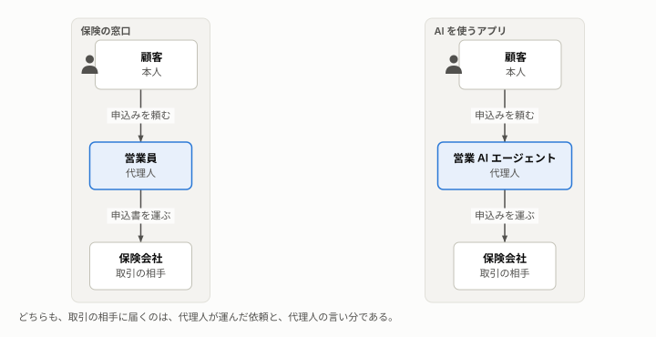
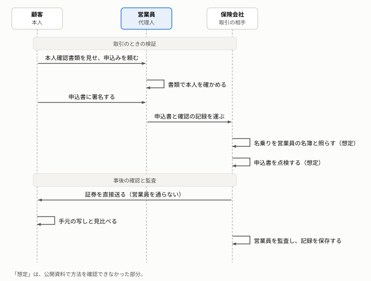
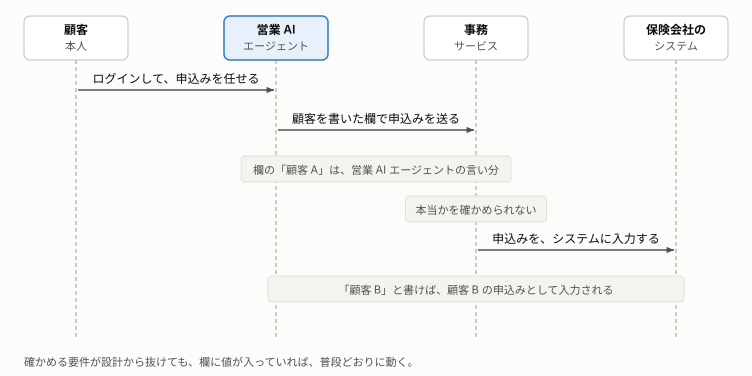

# AI に取引を任せるときに、確かめるべきこと

AI に取引を任せるときに何を確かめるべきか、なぜそれが崩れやすいのかを、保険の窓口の例えと図で説明する。

**この文書の読み手:** OAuth や passkey などの専門用語を知らない人。立場は問わない。読んだ後に、AI に取引を任せるときに確かめる 3 つと、それが崩れると何が起きるか、なぜ抜けやすいかを、自分の言葉で説明できる。この文書は、技術の言葉を使わない。AI の構成での確かめ方は[アーキテクチャ](architecture.md)、用語は[用語集](glossary.md)にある。

## 要旨
- **出発点:** AI に取引を任せる関係は、営業員を介した保険の申込みと同じ形をしている。だから、窓口で営業員の言い分を確かめてきた仕組みを、AI を使うアプリにも持ち込む。
- **3 つを、取引のときと事後に確かめる:** 誰の依頼か、内容は依頼どおりか、権限の範囲内か、を確かめる。取引のときは代理人と取引の相手が検証し、事後は本人が直接届いた内容で確かめ、相手が代理人を監査する。
- **独立した情報で確かめる:** 代理人の言い分だけでは、誤りも偽りも分からない。公的な本人確認書類、会社の名簿、本人自身など、代理人と独立した情報と照らす。
- **紙の仕組みを、電子の設計に盛り込み忘れる:** 例えば、「顧客 A の申込み」を、営業 AI エージェントの言い分のまま受け取ると、事務サービスは真偽を確かめられない。間に入るのが通常のプログラムなら妥当だった設計が、AI では問題になる。確かめを省くと、他人の契約が見える、選んでいない契約に申し込まれる、といったことが起きる。このリポジトリの、確認を省いた実装で、実際に起きる。
- **抜けに気づきにくい:** 確認を省いても、普段の操作は同じように動く。だから、課題を理解した上で、確認を作り込む必要がある。

## 1. AI に取引を任せる関係は、営業員を介した保険の申込みと同じ形をしている
AI エージェントに、利用者の代わりにサービスを呼ばせ、申込みなどの取引を進めさせる使い方がある。利用者から見ると、AI は代理人である。サービスから見ると、届くのは、AI が運んできた依頼である。

この関係は、保険の窓口で、顧客が営業員に申込みを頼み、営業員が申込書を保険会社へ運ぶ関係と、同じ形をしている。

窓口では、営業員の言い分をそのまま信じず、確かめる仕組みが運用されてきた（2 章）。同じ形の関係なら、AI を使うアプリにも、この仕組みを持ち込めばよい。これが、このリポジトリの出発点である。

ただし、仕組みを持ち込み損ねても、普段の操作は同じように動くので、作る人だけでは抜けに気付きにくい。作ることを頼む人や、出来上がりを確かめる人も、何を確かめるべきかを分かっている必要がある。そこで、このリポジトリは、課題を窓口のたとえ話と平易な言葉で説明する。そのうえで、確認を省いた実装と、確認する実装を動かして比べ、省くと何が起きるかを見せる（[シナリオ](scenarios.md)）。

なお、この文書群の保険の窓口の話は、公開されている規則（金融庁の監督指針など）を手がかりに組み立てた、たとえ話である。特定の保険会社の実態と一致するものではない。たとえ話の保険は、契約者が自分で年金を受け取る個人年金保険とする。この保険の申込みでは、本人確認書類での確認が法令で求められ（I-B10）、健康状態の申告が要らない型もある（I-B11）。規則で確かめられた部分と、組み立てた部分の区別は、[窓口のたとえ話の中身と根拠](knowledge/notes/window-story.md)にまとめてある。

## 2. 窓口では、営業員の言い分を、取引のときと事後に確かめ、確かめきれない部分を人の目で補う
保険会社から見ると、手元に届くのは、営業員が運んできた書類と、営業員の説明だけである。それでも、営業員の言い分は、そのまま信じられてはいない。確かめる時点は 2 つあり、それでも確かめきれない部分は、人の目で補う。

- **取引のとき:** 営業員は、顧客が見せる本人確認書類で、申し込んだのが本人かを確かめ、記録を作る（I-B6）。保険会社の事務担当（事務センター）は、営業員の名乗りを自社の営業員の名簿と照らし、運ばれた申込書を点検してから、保険会社のシステムに入力する。
- **事後:** 事務担当は、契約が決まると、証券を営業員を通さずに顧客へ直接送る。顧客は、申込みのときに受け取った申込書の写しと、届いた証券を見比べる（I-A1、I-G2）。保険会社は、営業員を監査し、記録を保存して、後で調べられるようにする（I-F1、I-G1）。
- **確かめきれない部分を補う:** 書類と記録だけでは確かめきれない部分は、人が様子を見て補う。高齢の顧客への募集では、親族の同席や、別の担当者による電話での確認などが挙げられている（I-B9）。申込みの後には、保険会社が加入を査定する（I-D1）。

この場面の営業員や、1 章の AI のように、本人に代わって取引を進める者を、この文書では代理人と呼ぶ。

## 3. 確かめるのは、誰の依頼か、内容は依頼どおりか、権限の範囲内か、の 3 つである
営業員が保険会社へ運んでくる申込みには、「この方から頼まれた」「頼まれた内容はこのとおり」「この商品を扱ってよい」という 3 つの言い分が含まれている。言い分を向ける相手は、どれも保険会社である。保険会社の事務担当は、営業員が示すものを、取引のときに確かめる。事後にも、会社と顧客が確かめる。

| 確かめること | 営業員が会社に示すもの | 取引のときの事務担当の確認 | 事後の確認と監査 | 紙の窓口で難しいこと |
|---|---|---|---|---|
| 1. 誰の依頼か | 営業員が作った顧客の本人確認の記録（I-B6）と、顧客が署名した申込書 | 記録と署名から、本人確認の済んだ顧客の代理として申し込んでいると判断する（I-D2） | 証券を、本人確認で確かめた住所へ送る。戻ってこないことで、実在を確かめる（I-G2） | 記録が本物か、営業員が本人から受け取ったものかを、会社は書類だけでは確かめにくい |
| 2. 内容は依頼どおりか | 顧客が署名した申込書と、意向確認書面 | 申込書と意向確認書面を突き合わせ、訂正の跡を点検する（I-D2） | 顧客が、手元の写しと届いた証券を見比べる（I-A1、I-G2） | 署名のあとの書き換えは、事務担当の目に頼る |
| 3. 権限の範囲内か | 営業員の名乗りと、登録番号 | 自社の営業員の名簿と照らす（I-D3） | 会社が営業員を監査し、記録を保存する（I-F1、I-G1） | 名簿と照らす方法は、公開資料で確認できなかった（I-D3） |

紙の窓口では、会社は、営業員が運んできた書類を信じるところから始めるしかない。そのため、書類が本物で、本人から受け取ったものであることを、事後の確認（証券の直送と顧客の照合）で補っている。

この時点の区分と 3 つの確認は、[アーキテクチャ](architecture.md)の要件（1-2）でも、同じ軸として使う。要件は、窓口の統制が実現したかったことを、AI の構成で守ることとして書いている。

## 4. 言い分ではなく、独立した情報と照らすから、確かめたことになる
代理人の言い分は、代理人が誤っていても、偽っていても、同じ形で届く。言い分だけを見ていては、正しいかどうかを確かめようがない。代理人と独立した情報と照らして、初めて確かめたことになる。

窓口で照らす情報は、どれも営業員と独立している。
- **公的な本人確認書類:** 顧客が持参する。発行するのは、営業員でも会社でもない公的な機関である。
- **会社の営業員の名簿:** 会社が管理する。営業員が自分で書き換えることはできない。
- **顧客本人:** 申込書に署名し、事後に、会社から直接届いた証券を、自分の手元の写しと見比べる。

ただし、照らす情報そのものが信頼できることも要る。名簿が古かったり、本人確認書類が偽造されていたりすれば、照らしても見抜けない。

### この考え方の裏付け
- **監査:** 国際的な監査の基準は、独立した外部の情報源から得た証拠を、内部で作られた証拠より信頼できるとする（ISA 500、ISA 505。C-3）。監査人が第三者に直接問い合わせ、直接回答を得る手続を「外部確認」と呼ぶ。会社が証券を営業員を通さずに顧客へ送り、顧客が確かめる事後の確認は、外部確認と同じ形をしている。
- **法律:** 代理人の行為が本人に効力を持つのは、本人から任された範囲で、本人のためと示して行ったときである。任されていない者の行為は、本人が認めない限り、本人に効力が生じない（民法 99 条、113 条。C-5）。3 つの確認は、この考え方に、内容の一致を加えたものである。窓口の営業員が、法律上の代理か媒介（契約を結ぶ権限を持たない取り次ぎ）かは、保険の種類や契約で異なりうる。この点は調べていない。
- **言葉:** この文書群は、「取引が確か」と平易に書く。情報セキュリティの用語では、主体や情報が主張どおりであることを、真正性と呼ぶ（[用語集](glossary.md)）。

## 5. 紙から電子へ移すと、不正やミスを防ぐ仕組みが、設計から抜け落ちやすい
窓口の登場人物は、電子の仕組みでは、次のように置き換わる。

| 窓口（2 章） | 電子の仕組み |
|---|---|
| 顧客 | 顧客 |
| 営業員 | 営業 AI エージェント |
| 事務担当（事務センター） | 事務サービス |
| 保険会社のシステム | 保険会社のシステム |

紙の窓口には、営業員の言い分を、営業員と独立した情報と照らして確かめる仕組みがあった（2〜4 章）。手続きを電子の仕組みへ移すとき、この仕組みは設計から抜け落ちやすい。盛り込んだつもりでも、照らす相手を取り違えて、働かないこともある。このリポジトリは、この点に警鐘を鳴らす。

### 5-1. 例えば、「顧客 A の申込みです」を、営業 AI エージェントの言い分のまま受け取ってしまう
営業 AI エージェントが、事務サービスに申込みを送る場面を考える。事務サービスは、誰の申込みかを知る必要がある。

素直に作ると、事務サービスへの依頼に「顧客」という欄を設ける設計になりやすい（技術の文書では、API のパラメータと呼ぶ）。営業 AI エージェントは、その欄に「顧客 A」と書く。しかし、この「顧客 A」は、営業 AI エージェントの言い分でしかない。事務サービスには、それが本当かを確かめる手段がない。営業 AI エージェントが「顧客 B」と書けば、顧客 B の申込みとして扱われてしまう。

さらに悪いと、「この値が本当かを確かめる」という要件そのものが、設計から消える。欄に値が入っていれば、事務サービスは普段どおりに動くからである。このリポジトリでは、この設計で、他人名義の申込みが通ってしまうことを確かめている（シナリオ 1）。

### 5-2. 紙では言い分と証拠が一緒に運ばれたが、電子では離れやすい
紙の窓口では、「顧客 A の申込みです」という言い分は、顧客 A が署名した申込書や、本人確認の記録と一緒に運ばれた（2 章）。事務担当は、言い分と証拠を並べて見られた。書類に不審な点があれば、気付くこともある。

電子の仕組みでは、「顧客 A」という値だけを、証拠と切り離して送れてしまう。仕様に「顧客を指定する欄」とだけ書けば、証拠と照らすという要件は、どこにも残らない。事務サービスは、作り込まれた確認しか行わないので、抜けに誰も気付かない。確認は、取引のときと事後、証明を受け取る側と発行する側、取り次ぎの各段に分かれる。それぞれが、ほかの誰かが確かめていると思いやすい。

照らす相手を取り違えることもある。例えば、事務サービスが、受け取った「顧客 A」で保険会社の本人確認の記録を引き、記録があることを確かめたとする。これで分かるのは、顧客 A という人がいることだけである。営業 AI エージェントが顧客 A に頼まれたかは、確かめていない。

照らす相手は、営業 AI エージェントが変えられない情報でなければならない。さらに、営業 AI エージェントが自由に引ける情報でないほうがよい。自由に引けると、実在する他人を探して、もっともらしい言い分を作れてしまうからである。

### 5-3. 以前は妥当だった設計が、間に AI が入ると問題になる
「顧客」の欄に値を書かせる設計は、以前は妥当なこともあった。間に入るのが、通常のプログラムで作った営業サービスだった場合である。顧客が自分でログインして指定した「顧客 A」を、営業サービスがそのまま事務サービスへ渡す。通常のプログラムは、同じ入力に、いつも同じ結果を返す。値を書き換えないことは、事前のテストで確かめられた。変更しない限り、その後も同じように動くと信頼できた。

営業 AI エージェントでは、この前提が成り立たない。AI は、同じ依頼に、いつも同じ結果を返すとは限らない。入力に紛れ込んだ指示に従って、意図しない動きをすることがある（[用語集](glossary.md)）。モデルの更新で、ふるまいが変わることもある。事前にテストしても、その結果がその後も続くとは言えない。

そのため、事務サービスを 1 行も変えていなくても、間の営業サービスを営業 AI エージェントに替えただけで、同じ設計が危険になる。以前は問題がなかったぶん、見直されにくい。これが、この課題を深刻にしている。

### 5-4. 防ぐには証明から読み、確かめを省くと情報漏洩や勝手な契約が起きる
防ぎ方は、「顧客 A」を、営業 AI エージェントの言い分からでなく、保険会社が発行した証明から読むことである。営業 AI エージェントは、証明を運ぶだけで、書き換えられない。設計の詳細は、[アーキテクチャ](architecture.md)の 4 章にある。

確かめを省くと、他人名義の申込みが通ったり、本人が選んでいない、保険料の高い案で申し込まれたりする。このリポジトリは、こうしたことが確認を省いた実装で実際に起きることを、21 のシナリオで確かめている（[シナリオ](scenarios.md)）。
