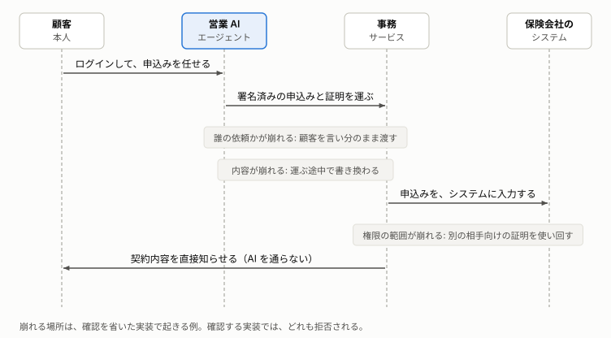

# 確認を省いたときのシナリオ

申込みで起こりうるリスク（想定される被害）に対して、リスクを顕在化させる手口と、防御の漏れを掛け合わせる。悪い実装で被害が出て、良い実装で出ないことを、テストで再現する手順をまとめる。

**この文書の読み手:** 実装者と、仕組みを手で確かめたい人。Node.js でテストと開発サーバーを動かせる。読んだ後に、各シナリオを自分の手で再現し、どのリスクを、どの防御が止めているかを、[アーキテクチャ](architecture.md)の検証項目（5 章）と結び付けられる。

## 要旨
- **リスク × 手口 × 防御の漏れで組む:** リスクは 9、手口は 16、防御は 19 ある。意味のある組み合わせを、20 のシナリオにした。想定される被害が、テストの期待結果である。攻撃は、すべて申込みである。
- **各シナリオで 3 つを確かめる:** 防御がすべてあれば被害は出ない。止める防御を 1 つずつ外しても、ほかの防御が止める。被害が出るのに必要な、最小の漏れの組を外すと、被害が出る。この最小の漏れの組を、悪い実装とする。
- **誰の依頼かを崩す手口の多くは、何段もの防御で止まる:** 例えば、欄に他人の名前を書く手口（シナリオ 1）は、5 つの防御のどれか 1 つでも止まる。
- **`npm test` が、全シナリオを自動で確かめる:** 期待する結果は `89 passed` である。
- **顧客のアプリの画面は、未実装である:** 顧客の操作は、テストの中でソフトウェア認証器が行う。

## 確認を省くと、取り次ぎの途中で 3 つの確認が崩れ、他人名義の申込みや勝手な契約が起きる
営業 AI エージェントから事務サービス、事務サービスから保険会社のシステムへと取り次ぐ途中に、3 つの確認それぞれが崩れる場所がある。登場人物は、[AI に取引を任せるときに、確かめるべきこと](purpose.md)の 5 章と同じである。この実装では、事務サービスは insurer-mcp、保険会社のシステムは insurer-backend である（[アーキテクチャ](architecture.md)の 2 章）。



崩れると、次のことが起きる。下の一覧の悪い実装で、実際に起きることを確かめている。

| 確かめること | 崩れ方 | 起きること | シナリオ |
|---|---|---|---|
| 1. 誰の依頼か | 「顧客 A」を、営業 AI エージェントの言い分のまま受け取る。偽造、期限切れ、別の用途のトークンを確かめない | 他人名義の申込みや、本人の知らない申込みが通る。本人確認の済んでいない人の申込みが通る | 1〜6 |
| 2. 内容は依頼どおりか | 営業 AI エージェントが、運ぶ途中で申込みの内容を書き換える | 本人が選んでいない、保険料の高い案で申し込まれる。保険会社が示していない案で、契約が記録される | 7〜11 |
| 3. 権限の範囲内か | 別の相手のためのトークンを使い回す。登録の外れた AI を止めない。発行が雑 | 範囲外の契約が通る。正規の取り次ぎを経ない申込みが通る。登録の外れた AI の申込みが通る | 12〜18 |

事後の確認が崩れると、顧客は契約内容で照合できず（シナリオ 19）、誰が取り次いだかも追えない（シナリオ 20）。

## リスク、手口、防御の一覧
### リスク（想定される被害。テストの期待結果）
「要件」の列は、[アーキテクチャ](architecture.md)の 1-2 の要件の番号である。

| ID | リスク | 確かめること | 時点 | 要件 |
|---|---|---|---|---|
| R1 | 他人名義の申込みが通る | 誰の依頼か | 取引のとき | 2 |
| R2 | 本人が承認していない申込みが、本人名義で通る | 誰の依頼か | 取引のとき | 2 |
| R3 | 本人確認の済んでいない人の申込みが通る | 誰の依頼か | 取引のとき | 1 |
| R4 | 本人が選んだ内容と違う契約になる | 内容 | 取引のとき | 3、4、6 |
| R5 | 同じ申込みが二重に契約される | 内容 | 取引のとき | 5 |
| R6 | 取決めの範囲外の契約が通る | 権限 | 取引のとき | 8 |
| R7 | 権限のない者や経路から、申込みが通る | 権限 | 取引のとき | 7、9 |
| R8 | 顧客が、届いた契約内容で照合できない | 内容 | 事後 | 10 |
| R9 | 誰が取り次いだかを、後から追えない | 権限 | 事後 | 11 |

### 手口（攻撃側の挑戦。乗っ取られた営業 AI エージェントが行う）
A1 欄に他人の名前を書く。A2 他人の本人確認の結果を名乗る。A3 トークンを偽造する（偽の署名、`alg=none`）。A4 期限切れのトークンを使う。A5 別の用途のトークン（ID トークン）を使う。A6 別の宛先のトークンで、保険会社のシステムへ直接申し込む。A7 受け取ったトークンを、そのまま奥へ流す。A8 署名のあとで内容を書き換える。A9 提示にない案で申し込む。A10 意向確認と違う申込みにすり替える。A11 同じ申込みを二度出す。A12 範囲外の案で申し込む。A13 登録が外れた後に申し込む。A14 違う内容で記録を作らせる。A15 通知先を書き換える。A16 雑な発行を悪用する（どこでも通るトークン、取決めの拡大、経由の消去）。

### 防御（外すと、防御の漏れになる）
| ID | 防御 | 外す設定（環境変数） |
|---|---|---|
| D1 | 事務サービスが、自分宛てのトークンかを確かめる | `MCP_INCOMING_CHECK=no-aud` |
| D2 | 事務サービスが、次の宛先のトークンに替えてもらう | `MCP_BACKEND_AUTH=passthrough`（素通し）、`client-credentials`（自分の資格で呼ぶ） |
| D3 | 認可サーバーが、宛先・期間・取決めを絞り、経由を残して発行する | `INSURER_MODE_AUTH=bad` |
| D4 | 認可サーバーが、登録の外れた AI に発行しない | （外す設定はない） |
| D5 | 保険会社のシステムが、トークンの署名を確かめる | `BACKEND_TICKET_CHECK=no-signature` |
| D6 | 保険会社のシステムが、トークンの期限を確かめる | `BACKEND_TICKET_CHECK=no-exp` |
| D7 | 保険会社のシステムが、トークンの宛先を確かめる | `BACKEND_TICKET_CHECK=no-aud` |
| D8 | 保険会社のシステムが、トークンの種類を確かめる | `BACKEND_TICKET_CHECK=no-typ` |
| D9 | 保険会社のシステムが、顧客を、トークンの本人から決める | `BACKEND_TRUST_FROM_USER=1` |
| D10 | 保険会社のシステムが、認可サーバーに、トークンと取り次いだ AI の有効性を問い合わせる | `BACKEND_REGISTRATION_CHECK=none` |
| D11 | 保険会社のシステムが、本人確認の結果を、トークンから読む | `BACKEND_IDENTITY_SOURCE=agent-claim` |
| D12 | 保険会社のシステムが、提示の署名と、案が提示に含まれることを確かめる | `BACKEND_OFFERS_CHECK=none` |
| D13 | 保険会社のシステムが、顧客の署名と、内容の一致を確かめる | `BACKEND_SEAL_CHECK=none`（`mtls-only`、`agent-signed` も不十分） |
| D14 | 保険会社のシステムが、意向確認と申込みの署名の連鎖を確かめる | `BACKEND_CHAIN_CHECK=none` |
| D15 | 保険会社のシステムが、取決め（scope と RAR）を確かめる | `BACKEND_RANGE_CHECK=none` |
| D16 | 保険会社のシステムが、使い捨ての値（`nonce`）を確かめる | `BACKEND_NONCE_CHECK=none` |
| D17 | 保険会社のシステムが、契約の記録を、署名済み申込から導出する | `BACKEND_INGEST=manual` |
| D18 | 保険会社のシステムが、通知を、登録済みの連絡先へ送る | `BACKEND_NOTIFY=from-application` |
| D19 | 顧客のアプリが、写しと通知を照合する（事後の検知） | （外す設定はない） |

## シナリオ一覧
「止める防御」は、どれか 1 つでもあれば被害が出ない防御である。「最小の漏れ」は、被害が出るのに外す必要がある防御で、これを悪い実装とする。番号は、テストの番号と同じである。

| # | リスク × 手口 | 止める防御 | 最小の漏れ（悪い実装） |
|---|---|---|---|
| 1 | R1 × A1 欄に「bob」と書いて申し込む | D2、D9、D11、D13、D14 | 全部。営業サービスを信頼し、顧客を欄で受け取る事務サービスに当たる |
| 2 | R1 × A3 偽造したトークン（本人を bob） | D5、D10、D13、D14 | 全部 |
| 3 | R2 × A3 偽造したトークン（本人を alice） | D5、D10、D13、D14 | 全部 |
| 4 | R2 × A4 期限切れのトークン | D6、D10、D13、D14 | 全部 |
| 5 | R2 × A5 ID トークン | D3、D7、D8、D11、D13、D14、D15 | D7 以外の 6 つ |
| 6 | R3 × A2 他人の確認結果を名乗る | D11 | D11 |
| 7 | R4 × A8 署名のあとで書き換える | D13、D14 | 両方 |
| 8 | R4 × A9 提示にない案 | D12 | D12 |
| 9 | R4 × A10 意向確認とすり替える | D14 | D14 |
| 10 | R4 × A14 違う内容で記録させる | D17 | D17 |
| 11 | R5 × A11 二度出す | D16 | D16 |
| 12 | R6 × A12 範囲外の案 | D15 | D15 |
| 13 | R6 × A16 替えるときに取決めを広げる | D3 | D3 |
| 14 | R7 × A6 営業 AI エージェント宛てのトークンで直接 | D7 | D7 |
| 15 | R7 × A7 事務サービス宛てのトークンを奥へ流す | D2、D7 | 両方 |
| 16 | R7 × A7 営業 AI エージェント宛てのトークンを事務サービス経由で奥まで | D1、D2、D7 | 全部 |
| 17 | R7 × A16 どこでも通るトークン | D3 | D3 |
| 18 | R7 × A13 登録の外れた営業 AI エージェント | D10 | D10 |
| 19 | R8 × A15 通知先を書き換える | D18 | D18 |
| 20 | R9 × A16 経由を残さない発行 | D3 | D3 |

ここにない組み合わせは、その手口ではそのリスクに届かないものである。例えば、期限切れのトークン（A4）では、トークンの本人を変えられないので、他人名義の申込み（R1）は起こせない。

## 再現の方法
テストは [test/scenarios.test.ts](../test/scenarios.test.ts) にある。台本の営業 AI エージェント（乗っ取られた AI を模す）とソフトウェア認証器で動く。本物の Claude とパスキーは使わない。

```sh
npm test                              # 全シナリオ。期待する結果: 89 passed
npx vitest run -t "1. R1 × A1"        # 1 つのシナリオだけ
```

各シナリオのテストは、3 種類の名前で並ぶ。「good（止める防御）: 被害は出ない」「good（D… だけを外す）: ほかの防御が止める」「bad（最小の漏れを外す）: 被害が出る」である。基本の流れ 1 件と、補足のテスト（`alg=none`、mTLS だけの署名、事後の照合など）もある。

サービスを悪い実装で起動するときは、上の防御の一覧の環境変数を指定する。`INSURER_MODE_BACKEND=bad` で保険会社のシステム、`INSURER_MODE_MCP=bad` で事務サービス、`INSURER_MODE_AUTH=bad` で認可サーバーが、まとめて悪い側になる。全体は `INSURER_MODE=bad` である。

## 各シナリオで見ること
- **シナリオ 1:** 悪い実装では、事務サービスが自分の資格で保険会社のシステムを呼び、保険会社のシステムは申込みの欄の顧客を信じる。顧客の署名も求めない。営業サービスを信頼していた以前の設計の形で、営業 AI エージェントに替えると危険になる（[AI に取引を任せるときに、確かめるべきこと](purpose.md)の 5-3）。
- **シナリオ 2〜5:** トークンの検証を外しても、発行元への問い合わせ（D10）と、顧客の署名（D13、D14）が止める。トークンが偽造でも、顧客の署名は作れない。
- **シナリオ 5:** ID トークンは、発行が丁寧なら宛先（D3、D7）で、そうでなくても種類（D8）で止まる。
- **シナリオ 7:** 乗っ取られた営業 AI エージェント（`SALES_AGENT_TAMPER=1` で入る）は、取決めの範囲で最も保険料が高い案に書き換える。署名の照合を外しても、意向確認とのつながりが止める。`mtls-only` と `agent-signed` は、署名を確かめたつもりでも、書き換えを止められない。
- **シナリオ 8:** 営業 AI エージェントが本物の提示から `nonce` だけ取り、案を足した偽の提示を作る。顧客のアプリが署名を確かめない場合を想定する。
- **シナリオ 12:** 署名を見ない実装でも、取決めがあれば範囲外の案は止まる。取決めは被害の範囲を限る。
- **シナリオ 14〜17、20:** 正規の経路（営業 AI エージェント → 事務サービス → 保険会社のシステム）を通らずに記録された契約は、経由の記録が欠ける。これを被害として判定する。
- **シナリオ 18:** トークンをもらったあとに登録が外れる。保険会社のシステムが認可サーバーへ問い合わせて、無効と知る。新しいトークンは出ない（D4）。
- **シナリオ 10、19:** 顧客の手元の写しと、保険会社から直接届いた通知を、`reconcile` が突き合わせる（D19）。不一致、未着、覚えのない契約を見つける。

簡略化した点は、[実装](implementation.md)の 5 章にある。
