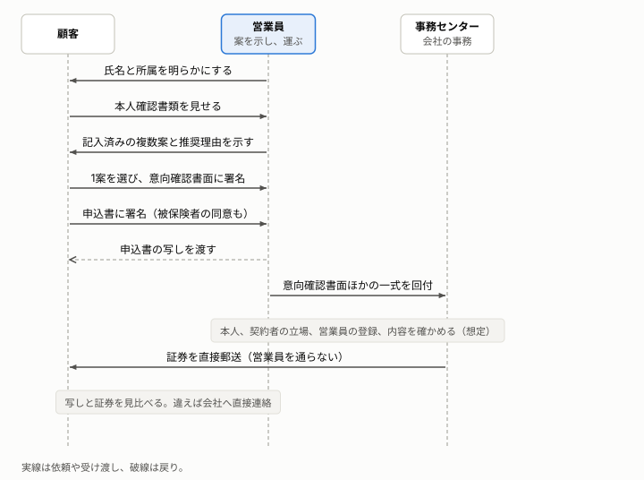

# 営業員が申込書を運んでも、会社が本人・立場・権限を確かめる設計と、直送の最後の確認が、合意の内容を守る

保険の窓口で、営業員が複数の案を示し、顧客が選んで申し込む場面を例に、運ぶ人がいても、申込みの正しさと合意の内容が守られる仕組みを説明する。

**この文書の読み手:** システムを発注する人、提案する人、作る人。OAuth や JWT の知識は要らない。読んだ後に、[用語の対応表](#6-仕様の用語との対応)を使って、技術者と同じ言葉で議論できる。営業員の役を機械が担う場合の設計は、[設計文書](research/dx-design.md)にある。

## 要旨
- **流れ:** 営業員が名乗り、顧客の本人確認書類を確かめ、複数の案を示す。顧客が 1 つ選んで署名し、営業員は、一式を事務センターへ回す。
- **会社は、回付された一式で 4 つを確かめる（想定）:** 誰が申し込んだか、誰のための契約か、どの権限の営業員か、内容が署名したときのままか。
- **営業員は、案の選別と一式の運搬に関わる:** 運ぶ途中で内容が変わる危険は、営業員の注意深さでは消せない。
- **最後の確認は、営業員を通らない（想定）:** 会社が証券を顧客へ直接送り、顧客が手元の写しと見比べる。代理店を介さずに証券を交付する措置は実在する。会社の営業員への適用と、事務センターの運用は想定である。
- **事務センターが営業員を確かめる方法は、確認できなかった想定である:** 想定の範囲を明示する（[5](#5-実在する仕組みと想定の区別)）。

## 1. 登場人物は、顧客、営業員、事務センター、保険会社である
顧客は、保険に申し込む人である。営業員は、顧客の相談に乗り、案を示し、申込書を運ぶ。事務センターは、会社の事務を担い、回付された一式を点検する。保険会社は、営業員を登録し、案を作り、証券を発行する。

## 2. 流れは 10 段である
次の 10 段で、来店から確認までが完結する。

| 段 | 何が起きるか | 根拠 |
|---|---|---|
| 1. 名乗り | 営業員が、氏名と所属を明らかにする。取り扱える保険会社の範囲を説明する | I-B8 |
| 2. 本人確認 | 営業員が、本人確認書類の原本で、顧客の氏名・住居・生年月日を確かめ、確認記録を作る。取引の目的と職業は、顧客の申告を受ける | I-B6 |
| 3. 相談 | 営業員が、希望や事情を聞く。誰のための契約か（被保険者、対象物）を確かめる | I-B2、I-B7 |
| 4. 提示 | 営業員が、記入済みの複数案を設計書と比較表で示す。推奨する案には、理由を説明する。手数料で誘導しない。この段に、顧客の署名は要らない | I-A2、I-B5、記入の運用は想定 |
| 5. 意向確認 | 顧客が 1 案を選び、意向確認書面で、自分の意向と案が合うことを確かめて署名する | I-B2、I-B5 |
| 6. 申込み | 顧客が申込書に署名する。告知は、本人が書面で行う。被保険者が別人なら、被保険者も同意の署名をする。顧客は、申込書の写しを受け取る。保険料は、会社へ直接払い込むか、会社所定の領収証を受け取る | I-B3、I-B7、I-A1、I-G3 |
| 7. 回付 | 営業員が、意向確認書面、申込書、確認記録と書類の写し、被保険者の同意、登録番号を一式にして、事務センターへ回す | 一式の中身と運用は想定 |
| 8. 点検 | 事務担当が、一式を確かめ（[3](#3-回付された一式で会社が確かめる-4-つ)）、契約の記録を作る。会社が加入を査定する | I-D1、点検と記録の作成は想定 |
| 9. 直送 | 事務センターが、営業員を通さずに、本人確認済みの住所へ証券を郵送する | I-G2。代理店を介さない措置は実在。営業員への適用と住所の確認は想定 |
| 10. 照合 | 顧客が、手元の写しと証券を見比べる。違えば、営業員を通さずに、会社へ直接連絡する | I-G2 |

根拠の番号は、[事実集](research/findings.md)の項目である。

## 3. 回付された一式で、会社が確かめる 4 つ
営業員は、自分の言葉でなく、書類で証明する。事務センターは、一式の書類で、次の 4 つを確かめる。

| 確かめること | 一式の中身 | 事務センターの確認 | 根拠 |
|---|---|---|---|
| 誰が申し込んだか（本人） | 本人確認の記録と、書類の写し | 記録が揃い、申込書の署名と同じ人かを点検する | I-B6、点検は想定 |
| 誰のための契約か（立場） | 被保険者の同意の署名。対象物の所有を示す書類 | 他人を被保険者とする死亡保険などは、同意がなければ効力が生じない。所有の確認は未調査 | I-B7、I-X1 |
| どの権限の営業員か | 氏名、所属、登録番号 | 登録が有効で、扱える範囲の申込みかを、会社の登録の記録で確かめる | I-B8、I-D3、確認は想定 |
| 内容が署名したときのままか | 顧客が署名した意向確認書面と、申込書 | 選んだ案と申込書の内容が一致するか、署名のあとの訂正や不審な箇所がないかを、事務担当が目で点検する。訂正印、契印、大字などの跡を見る。担当者の技能に頼る | 想定（I-D2）。顧客の写し（I-A1）が事後の守り |

4 つ目は、営業員が署名のあとで内容を変えていないかの確認である。窓口では、事務担当の技能に頼る（想定）。不審な箇所に気付けるかは、担当者の経験による。会社の側に、署名したときの内容を直接確かめる手段がないためである（推定）。そのため、顧客の写しと、証券が届いた後の見比べ（[4](#4-営業員が内容を変えても最後の確認で見つかる)）が、事後の守りになる。

告知の内容の査定（I-D1）と、保険料の入金は、別の段で扱う。ここは、申込みの正しさの確認に絞る。

営業員の登録は、所属する保険会社が代理して申請できる（要約のみ）。そのため、会社は、自社の営業員の登録を把握している（推定）。事務センターが営業員を確かめる方法は、公開資料から確認できなかった。

## 4. 営業員が内容を変えても、最後の確認で見つかる
営業員が、顧客の知らないうちに案を差し替えたり、申込書を書き換えたりしたとする。申込書は、営業員の手を通って事務センターへ届く。事務センターは、意向確認書面との食い違いや、訂正の跡を点検する（想定）。それでも見つからなければ、受け取った申込書のとおりに契約を結び、証券を顧客へ送る。

顧客の手元には、署名したときの写しがある。証券が届くと、顧客は写しと見比べる。内容が違えば、顧客は、営業員を通さずに、会社へ連絡できる。営業員は、この確認の経路を握れない。金融庁の監督指針は、不正契約の防止のため、証券の交付を、正当な理由なく代理店を介して行わない措置を求めている（I-G2、保険代理店の管理の項）。

この確認には限りがある。
- **顧客が見比べなければ、見つからない:** 写しを渡しても、顧客が読むとは限らない（推定）。
- **送り先を営業員が書けば、確認が破られる:** 営業員が別の住所を書けば、証券が営業員の手元に届く。そのため、送り先は、本人確認書類で確かめた住所にする。証券を郵送して返戻されないことで、実在を確かめる方法もある（I-G2）。
- **署名する前の差し替えは、別の守りが要る:** 提示した案が、営業員に書き換えられていないことは、この確認では分からない。署名の前に、顧客が案を確かめる必要がある。
- **団体の契約などでは、勤務先を経由して渡す場合がある:** 全ての契約が直送とは限らない（I-G2）。

## 5. 実在する仕組みと想定の区別
この例えは、確認できた仕組みと、確認できなかった運用でできている。

| 例えの要素 | 実在の仕組み | 確認の状況 |
|---|---|---|
| 名乗りと、氏名・所属の明示 | 営業員は、顧客に氏名を明らかにする。意向確認書面に、募集人の氏名・名称を記載する（金融庁の監督指針） | 実在（I-B8）。本文確認 |
| 本人確認書類の原本による確認と記録 | 本人確認書類の原本で確認し、コピーの提示だけでは認めない。確認の記録を作る | 実在（I-B6）。本文確認 |
| 被保険者の同意 | 他人を被保険者とする死亡保険は、同意がなければ効力が生じない（保険法 38 条） | 実在（I-B7）。本文確認 |
| 意向確認書面、比較と推奨理由、申込書の写し | 意向の把握、推奨の理由の説明、申込書の写しの交付（同） | 実在（I-B2、I-A2、I-A1）。本文確認 |
| 告知は本人が書面で | 営業職員に口頭で伝えても、告知にならない | 実在（I-B3）。要約のみ |
| 保険料の領収 | 領収証を発行する。代理店が領収した保険料は区分して会社に精算する | 実在（I-G3）。本文確認 |
| 証券を、代理店を介さずに交付 | 正当な理由なく代理店を介して行わない措置を求める。証券の郵送と返戻の有無による実在確認もある | 実在（I-G2）。本文確認。保険代理店の管理の項で、会社の営業員への適用は想定 |
| 営業員が記入済みの複数案を示す | 営業員が設計書を作って示す運用 | 規定は確認できず（I-A3）。想定 |
| 回付される一式の中身 | 確認記録と書類の写しを、申込書に添えて回す運用 | 確認できず（I-B6、I-D2）。想定 |
| 事務センターの点検と、営業員の確認 | 申込書の点検、営業員の登録と権限の確認 | 確認できず（I-D2、I-D3）。想定 |
| 送り先を本人確認済みの住所にする | 証券の送付先の確認 | 確認できず。想定 |

## 6. 仕様の用語との対応
| 窓口の言葉 | 仕様・設計の用語 | 意味 |
|---|---|---|
| 営業員 | AI エージェント | 案を選別し、説明し、申込書を運ぶ役。人でなく AI が務める |
| 保険会社 | 認可サーバーとバックエンド | 営業員の登録、案の作成、証券の発行を担う。サービスを提供する側 |
| 営業員の登録 | クライアント登録（RFC 7591） | AI を認可サーバーに登録し、権限の範囲を結び付ける |
| 営業員の名乗り | 保険会社が署名した登録情報（仮称） | 顧客のアプリが、登録情報を検証して、氏名・所属・扱える範囲を示す。AI の自己申告に頼らない |
| 本人確認書類の確認と記録 | 本人確認（verified_claims） | 確認の方法、日時、根拠を、確認済みの属性に添えて保持する |
| 回付される一式 | 署名済み申込と、本人確認の属性の参照（設計での整理） | 一式をバックエンドが検証する |
| 被保険者の同意 | 被保険者自身の署名（設計での整理） | 被保険者が、自分の端末で署名する |
| 設計書の案 | 保険会社が署名した案（署名つきの提示、仮称） | AI は選別できるが、中身は変えられない |
| 意向確認書面、申込書への署名 | 利用者の鍵による署名（passkey） | 意向確認は、選んだ案、案の全体の識別子（提示集合の識別子、仮称）、意向の値が対象。申込みは、申込内容と意向確認の署名の値が対象 |
| 申込書の写し | 署名済み申込の写し（設計での整理） | 顧客のアプリが保存する |
| 回付 | token exchange（RFC 8693） | 本人が残り、AI の経由が `act` に残る |
| 事務センターの確認 | バックエンドでの検証（設計での整理） | トークンの有効性の問い合わせ（RFC 7662）で、AI の登録の有効性を確かめる |
| 営業員の登録の失効 | トークンの失効（RFC 7009） | 失効後の申込みを受け付けない |
| 内容が署名したときのままかの確認 | 署名の検証（署名とハッシュ値の照合） | 窓口では事務担当の技能に頼る確認を、機械で毎回、確かめられる |
| 契約の記録を作ること | 署名済み申込から、決定論的なプログラムが取り込む（設計での整理） | 人が入力し直さないので、申し込まれた内容と違う内容を入力する経路がない。プログラムと記録の保全は残る |
| 営業員を通さない直送 | AI を経由しない通知（直送の通知、仮称） | 本人確認で確かめた経路へ、保険会社から直接送る |
| 写しと証券の見比べ | アプリでの自動照合（設計での整理） | 不一致なら、保険会社へ直接通報する |
| 客が持ち込んだ指示に従う営業員 | プロンプトインジェクション | 入力に紛れた指示で、AI が意図しない動きをする |

**（仮称）** は、この設計での呼び名で、標準の用語ではない。**（設計での整理）** は、標準の用語ではなく、この設計の構成を説明する言葉である。印のない言葉は、標準の用語である。

仕様の番号は、一次資料で確認したものと、未確認のものがある。確認の状況は[設計文書](research/dx-design.md)にある。
